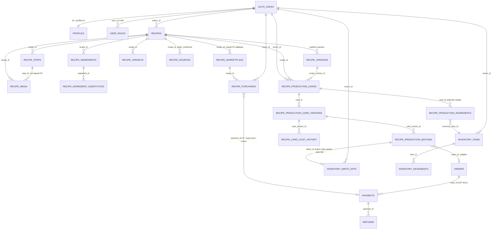

# RECIPE-01 — Полный аудит рецептурной системы и целевая архитектура унификации

**Репозиторий:** `uezdtort-tech/conditera` · **Дата аудита:** 2026-11-08 · **Режим:** только чтение
**Git HEAD на момент аудита:** `fe8beb0cce925dc839dbf96c790f5869adbef002` (main, ahead 187 / behind 0 vs origin/main)
**Рабочее дерево:** чистое; 4 защищённых upload-файла присутствуют на диске, skip-worktree не установлен.
**Метод верификации:** каждый вывод подтверждён чтением кода (file:line), DDL миграций и/или живой
read-only интроспекцией БД (PostgreSQL 18.4, information_schema / pg_policies / pg_constraint).
Блокер B1 (`0064_supplier_procurement.sql`, text=uuid) в рамках RECIPE-01 не затрагивался и на
рецептурные таблицы не влияет (0064 откатывается целиком, ledger = 63 миграции).

---

## A. Executive summary

### A.1. Общее состояние

Фактически в репозитории сосуществуют **три независимых «рецептурных контура»** на **трёх разных
наборах таблиц**, слабо связанных между собой:

| # | Контур | Таблицы | Реальное состояние |
|---|---|---|---|
| I | **Контентный** (блог/контент рецептов, MDX) | `recipes`, `recipe_acceptances` (0010) | Таблица жива (1 демо-строка), публичного UI нет; используется как FK-цель для `products.recipe_id`, `recipe_ingredients.recipe_id`, читается очередью модерации и recipe-stats. Запись из UI — нет |
| II | **Коммерческий маркетплейс** (платные рецепты, роялти) | `recipe_marketplace`, `recipe_purchases`, `recipe_subscriptions` (0012) | **Единственный реально работающий публичный контур**: каталог `/recipes`, карточка, покупка (201 по e2e-протоколу), дашборд автора. Роль издателя — только RECIPE_DEVELOPER |
| III | **Производственный** (нормы ингредиентов, склад) | `recipes` → `recipe_ingredients` (0053) → `inventory_items` (0010), движения 0046/0048/0049 | Расчётная цепочка «заказ → товар → рецепт → ингредиенты → склад» **кодом работает**, но данные в `recipe_ingredients` некому ввести из приложения (0 операций записи в src/) |

Параллельно существует **четвёртый, демонстрационный слой**: Zustand-стор `store.recipes`
(MOCK_RECIPES) с 4 action'ами, который до сих пор смонтирован во вкладке «Рецепты» кабинета
кондитера и создаёт у кондитера иллюзию работающих рецептов.

### A.2. Что уже работает (подтверждено)

1. **Каталог и карточка рецептов** на реальном API: `recipes-catalog.tsx:81` → `GET /api/recipes/marketplace`
   → `recipe_marketplace` (после конвергенции 2026-10-31 мок-фолбэк каталога убран).
2. **Создание/удаление рецепта автором** RECIPE_DEVELOPER: POST/DELETE `/api/recipes/marketplace`
   реально пишут в БД; ownership проверяется на сервере (PATCH `[id]/route.ts:138-143`).
3. **Покупка рецепта**: POST `.../purchase` → INSERT в `recipe_purchases` с роялти/комиссией,
   идемпотентность по (recipe_id, buyer_id, is_active) — подтверждено e2e-протоколом
   `docs/evidence/e2e-tally/recipe-purchase-flow.prod.json` (201).
4. **RLS** на всех таблицах контуров I–II (проверено по `pg_policies`, 18 политик).
5. **Расчёт потребности в сырье** по заказу: `ops/breakdown.ts` реально читает
   `recipe_ingredients` + склад владельца, конвертирует единицы (г/кг/мл/л/шт/дес), считает
   дефицит и закупочный черновик; связь «ингредиент ↔ складская позиция» существует через
   FK `recipe_ingredients.inventory_item_id` (SET NULL) + фолбэк по имени.
6. **Атомарное списание** с идемпотентностью: RPC `apply_inventory_movement_atomic` (0048) +
   реестр `inventory_write_offs` с sha256-подписью батча (0049, UNIQUE(owner, order, signature)),
   регрессионный тест `write-off.idempotency.test.ts`.

### A.3. Что существует только в интерфейсе (не доходит до БД)

1. **Вкладка «Рецепты» кабинета кондитера** (`ConfectionerRecipesManager`): форма создания/редактирования
   (название, ингредиенты, шаги, цена) пишет **только в Zustand** (`addRecipe` → `set({recipes})`,
   store.ts:663-673). `recipes` **не входит** в persist `partialize` (store.ts:2234-2248) → после
   перезагрузки всё исчезает; в публичный каталог не попадает никогда. Кондитер (CONFECTIONER)
   **не имеет ни одного пути опубликовать рецепт в БД**.
2. **«В избранное» / «Сохранить»** на карточке рецепта — только `toast.success`, ничего не сохраняет
   (recipe-detail-page.tsx:397-426); флаг `purchased` — client-state, сбрасывается при reload.
3. **Пересчёт порций** — степпер `useState(4)` (recipe-detail-page.tsx:56), в БД `servings` нет,
   ингредиенты не масштабируются.

### A.4. Критические дефекты

| # | Дефект | Доказательство |
|---|---|---|
| D1 | **«Принять рецепт в работу» сломан**: INSERT в `recipe_acceptances` использует колонки (`confectioner_id, price_from, price_to, prep_days, delivery, self_pickup, notes, status`), которых нет в таблице (фактические: `recipe_id, user_id, rating, comment, photo_url`) → PGRST204/500 | accept/route.ts:140-155 vs live-схема; миграций, меняющих таблицу, нет (grep supabase/) |
| D2 | **Список принявших деградирует в мок**: при ошибке/пустой БД API отдаёт `MOCK_ACCEPTANCES` — фиктивные «кондитеры рядом» в проде | acceptances/route.ts:284-286 |
| D3 | **Платный рецепт «покупается» без оплаты**: `payment_id` принимается из body и никогда не проверяется | purchase/route.ts:108-116 |
| D4 | **Контент не за пейволлом**: GET карточки делает `select("*")` — steps_json/ingredients_json отдаются всем без проверки покупки | `[id]/route.ts:55-59` |
| D5 | **Форма автора-разработчика — заглушка**: ингредиенты/шаги уходят в БД константами-заглушками, фото-поля нет | recipe-developer-dashboard.tsx:607-608 |
| D6 | **Модерация рецептов не работает**: очередь читает `recipes`, но `/api/moderator/action` не знает type="recipe" → 400 | moderator/action/route.ts:37-45 |
| D7 | **Нет единой сущности рецепта**: три контура, дублирующие поля (title/description/time/difficulty в 3 таблицах), FK-цели разъехались | 0010, 0012, live-схема |
| D8 | **Технологической карты как сущности нет**: grep `production_card|tech_card` по миграциям и src = 0; роль ТК исполняют 3 несвязанных артефакта | см. §I |
| D9 | **4+ независимых расчёта денег** (себестоимость/стоимость склада/закупки) — см. §10/§E.9 | breakdown.ts:352-360; rules.ts:509-513; supplier/dashboard/route.ts:152-155; confectioner-extra-tabs.tsx:1050 |
| D10 | **Редактирование рецепта задним числом меняет уже оформленные заказы**: breakdown читает живые `recipe_ingredients`, снапшота нет | write-off/route.ts:8-9; breakdown.ts:221-228 |
| D11 | Прямые UPDATE `quantity` мимо журнала движений | inventory/items PATCH :198-204; supplier/products PATCH :260-264 |

### A.5. Критические риски

- **Репутационный:** прод-пользователь видит фиктивных кондитеров (D2) и «покупает» платные рецепты бесплатно (D3).
- **Продуктовый:** кондитер не может довести рецепт до товара/производства — разрыв между контентом и коммерцией (A.3, D5).
- **Финансовый:** роялти фиксируется, но выплатной механики нет; списание может быть повторено через /movements мимо реестра.
- **Архитектурный:** дальнейшее наращивание любого из трёх контуров углубляет дублирование (D7).

---

## B. Реестр существующих реализаций

### B.1. Таблицы БД (живая интроспекция, PostgreSQL 18.4; RLS проверен по pg_policies)

| Таблица | Миграция | Строк (live) | Назначение | Статус | RLS |
|---|---|---|---|---|---|
| `recipes` | 0010:106-138 | 1 (демо «Красный бархат») | Контентные рецепты: content MDX, nutrition (calories/protein/fat/carb), status draft/published | **Полуживой**: FK-цель, читается модерацией/статистикой; UI-записи нет | 3 политики (select public / insert+update own) |
| `recipe_acceptances` | 0010:146-155 | 0 | «Кондитер принял рецепт» (_rating/comment_) | **Сломан** (D1): API пишет несуществующие колонки | 2 политики |
| `recipe_marketplace` | 0012:64-87 | 3 (published) | Платные рецепты: steps_json, ingredients_json, base_price, royalty_rate, difficulty 1-5 | **Работает** (чтение+запись API) | 5 политик |
| `recipe_purchases` | 0012:97-109 | 0 | Покупки: price_paid, royalty_amount, commission_amount, payment_id | Работает (запись), оплата не enforced (D3) | 3 политики |
| `recipe_subscriptions` | 0012:118-131 | 0 | Подписки на автора | **Таблица без кода** (API/UI нет; «Скоро» в дашборде) | 3 политики |
| `recipe_ingredients` | 0053:132-141 | 5 (демо-рецепт, 4/5 связаны со складом) | Нормализованные нормы: name, qty numeric(12,3), unit, **inventory_item_id FK**, sort_order | **Читается** breakdown; записи из приложения нет | SELECT-only |
| `inventory_items` | 0010:218-231 | 12 | Склад: owner_id, quantity numeric, unit TEXT (свободный), cost_per_unit INTEGER, supplier | Работает (свой CRUD API) | ALL own |
| `inventory_movements` | 0046:17-26 | 12 | Журнал движений IN/OUT/ADJUST | Работает (через RPC 0048) | **RLS НЕ включён** |
| `inventory_write_offs` | 0049:17-26 | 0 | Идемпотентность списаний (signature UNIQUE) | Работает | **RLS НЕ включён** (service role) |
| `order_production` / `order_production_checklist` | 0054:118-166 | 0 | Производственные метки заказа: оценка времени, риск, чеклист 10 стадий | Работает (время/статусы), со складом не связан | SELECT-only |
| `stock_movements` (легаси) | 0010:236-243 | 0 | Старый журнал (inventory_id) | **Мёртвый** (новая цепочка не использует) | — |

### B.2. API-маршруты

| Маршрут | Методы | Файл | Статус |
|---|---|---|---|
| `/api/recipes/marketplace` | GET, POST | `src/app/api/recipes/marketplace/route.ts` | Работает; POST: requireRole RECIPE_DEVELOPER (:200-207), ручная валидация (:212-246), slug-уникальность (:252-256) |
| `/api/recipes/marketplace/[id]` | GET, PATCH, DELETE | `src/app/api/recipes/marketplace/[id]/route.ts` | Работает; GET без пейволла (D4); views race (:88-92); DELETE soft при наличии покупок (:256-260); **PATCH без UI-потребителя** |
| `/api/recipes/marketplace/[id]/purchase` | POST | `.../purchase/route.ts` | Работает; оплата не enforced (D3); royalty = price×royalty_rate, комиссия 10% (:104-105) |
| `/api/recipes/[id]/accept` | POST | `src/app/api/recipes/[id]/accept/route.ts` | **Сломан** (D1) |
| `/api/recipes/[id]/acceptances` | GET | `src/app/api/recipes/[id]/acceptances/route.ts` | Деградирует в мок (D2) |
| `/api/confectioner/recipe-acceptances` | GET | `src/app/api/confectioner/recipe-acceptances/route.ts` | Сломан (D1) + семантика: `confectioner_id = user.id` вместо `confectioners.id` (:39-44) |
| `/api/confectioner/recipe-stats` | GET | `src/app/api/confectioner/recipe-stats/route.ts` | Работает с фолбэками на audit_logs; читает старую `recipes` (:164-167) |
| `/api/moderator/queue` + `/api/moderator/action` | GET, POST | `src/app/api/moderator/*` | Очередь читает `recipes` (:163-189), action type="recipe" → 400 (D6) |
| `/api/upload` | POST | `src/app/api/upload/route.ts` (ЗАЩИЩЁН, не меняем) | Общий; медиа рецептов = generic category=recipe |
| `/api/inventory/items` `/movements` `/write-off` | CRUD | `src/app/api/inventory/*` | Работают; write-off идемпотентен (sha256-батч, :60-70) |

### B.3. Библиотеки (src/lib)

| Файл | Назначение | Статус |
|---|---|---|
| `recipe-view-model.ts` | Маппер строки `recipe_marketplace` → UI Recipe; дефолт-заглушки честные («Имени автора в таблице нет», :128-129) | Работает; потребители: каталог + деталь. Докстринг заявляет юнит-тесты — их нет |
| `ops/breakdown.ts` | Потребность заказа в сырье → склад → дефицит → estimated_cost | Работает (§C.4) |
| `ops/units.ts` | Словарь единиц: г/гр/кг/ml/л/шт/дес(×10); `convertQty` | Работает; **нет**: ложек, стаканов, упаковок, «по вкусу» |
| `ops/acceptance.ts`, `ops/production-duration.ts`, `ops/assignment.ts` | Время производства из recipes.prep/cook; позиции заказа = recipe_id × qty | Работают (контур III) |
| `store.ts` recipes-слои | addRecipe(:663-673) и createRecipe/updateRecipe/deleteRecipe(:1373-1394) — **дубль семантики**, id-форматы разные (`recipe_*` vs `rc*`) | **Демо**, без сети, без persist |
| `supabase/types.ts:194-255` | Ручные типы RecipeMarketplace/Purchase/Subscription | Работает |
| `meilisearch.ts:49` (`recipes` индекс), `schema-org.tsx:147` (recipeJsonLd), `backup.ts:137`, `cleanup.ts:569`, `prisma/schema.prisma:688-715` | Объявления без потребителей | **Мёртвые** |

### B.4. Компоненты UI

| Компонент | Файл | Источник данных | Запись | Статус |
|---|---|---|---|---|
| Каталог `/recipes` | `pages/recipes-catalog.tsx` (395 стр.) | TanStack Query → API (`?sort=popular&limit=100`) | нет | Живой; пагинации нет, фильтры клиентские (:95-133) |
| Деталь рецепта | `pages/recipe-detail-page.tsx` (811 стр.) | API карточка + acceptances | purchase, accept; избранное/сохранить — фикция | Живой; `expert`→«Легко» баг словаря (:44-48,307); «Рекомендации» захардкожены (:551-563) |
| Оболочка `/recipes` | `components/recipes-route.tsx` (98 стр.) | URL/store nav | нет | Живой; файла `pages/recipes-route.tsx` **не существует** (дубля нет) |
| Вкладка «Рецепты» кондитера | `dashboard/confectioner-promotions-recipes-manager.tsx:218-552` | **store.recipes (мок)** | addRecipe/updateRecipe/deleteRecipe → Zustand | Живой-смонтирован, **демо-слой** (A.3) |
| Дашборд RECIPE_DEVELOPER | `dashboard/recipe-developer-dashboard.tsx` (756 стр.) | supabaseBrowser (RLS) + API | POST/DELETE marketplace | Живой; форма-заглушка (D5); вкладка подписок «Скоро» |
| «Статистика рецептов» кондитера | `dashboard/confectioner-recipe-stats-tab.tsx` (355 стр.) | GET /api/confectioner/recipe-stats | нет | Живой |
| `ConfectionerRecipesTab` + его диалог | `dashboard/confectioner-extra-tabs.tsx:665-950` | store | store | **Мёртвый** (0 импортёров; мусор «基本信息» в :901) |
| `ImageUploader` | `components/ui/image-uploader.tsx` | — | — | **Мёртвый** (заглушка «В реальном приложении — POST /api/upload») |

### B.5. Тесты (существующие)

| Тест | Покрывает | Реально проверяет |
|---|---|---|
| `pages/recipes-page.test.tsx` (5 тестов) | Каталог | Запрос `?sort=popular&limit=100`, клик→navigate с uuid из БД, error/empty/skeleton |
| `ops/breakdown.test.ts` | Контур III | Потребность/дефицит/статусы, связка со складом |
| `ops/units.test.ts` | Конверсия единиц | г/кг/мл/л/шт/дес; несовместимые → unit_mismatch |
| `api/inventory/write-off.idempotency.test.ts` | Списание | Контракт 0048/0049: дедуп по signature |
| `ops/risk.test.ts`, `ops/capacity.test.ts`, `ops/deadline.test.ts` | Производство | Время/риск/окна (не склад) |
| `tests/e2e/recipe-purchase-flow.spec.ts` (7/7 в prod-протоколе) | Контракт | GET-список/карточка/401 на purchase; **реальную покупку не выполняет** |

**Отсутствуют:** юнит-тесты всех мутаций marketplace (POST/PATCH/DELETE), purchase (кроме e2e-контракта 401), accept, recipe-stats, recipe-view-model; любые тесты медиа, порций, версий, импорта.

---

## C. Карта потоков данных

### C.1. Чтение каталога (работает)
`/recipes` → `recipes-catalog.tsx:81` csrfFetch → `GET /api/recipes/marketplace` → `supabaseAdmin.from("recipe_marketplace").eq("is_published", true)` (:76-86) → Postgres → `mapMarketplaceRowsToRecipes` (`recipe-view-model.ts:156`) → UI.

### C.2. Создание рецепта (только RECIPE_DEVELOPER)
Форма `CreateRecipeDialog` → `POST /api/recipes/marketplace` (dashboard:150-154) → requireRole → валидация → INSERT `recipe_marketplace` (route.ts:285-289). **Контент ингредиентов/шагов — заглушки (D5); фото — null.**
Путь кондитера: форма → `addRecipe` → `set({recipes: [...]})` (store.ts:663-673) → **конец. В БД не попадает, после reload исчезает.**

### C.3. Покупка (работает, без оплаты)
Кнопка «Купить» → POST `.../purchase` → идемпотент-проверка (:86-92) → расчёт royalty/commission (:104-105) → INSERT `recipe_purchases` (:119-131) → read-modify-write `purchases_count` (:142-147, неатомарно). Контент карточки при этом и так открыт всем (D4).

### C.4. Производственный расчёт (код работает, данные из вне)
Заказ → `order_items` (recipe_id × qty) → `computeIngredientNeeds` (breakdown.ts:205-387):
SQL A — `recipe_ingredients WHERE recipe_id = ANY(...)` (:221-228); SQL B — `inventory_items WHERE owner_id=$1 AND is_active` (:234-239); агрегация по inventory_item_id **или имени** (:296-300); конверсия `convertQty` (units.ts:87-93); дефицит → `Math.ceil(shortage_in_warehouse_unit) × cost_per_unit` (:352-360).

### C.5. Списание сырья (ручное, идемпотентное)
UI order-breakdown-dialog (:140-158) → `POST /api/inventory/write-off` → sha256 `item_id:qty` подпись (:60-70) → поиск в `inventory_write_offs` UNIQUE(owner,order,signature) → если новый: RPC `apply_inventory_movement_atomic` (0048: FOR UPDATE → проверка остатка → UPDATE quantity + INSERT movement) → запись в реестр. **Автоматического списания при производстве нет** (production/complete обновляет только completed_at, :69).

### C.6. «Принять рецепт» (сломан)
Карточка → POST `/api/recipes/[id]/accept` → валидация ОК → INSERT с 9 колонками, из которых 8 не существуют → **ошибка БД** → UI: «Не удалось создать подтверждение». Список acceptances: SELECT падает на `.eq("status","active")` → catch → audit_logs → при пустоте **MOCK_ACCEPTANCES**.

### C.7. Персистентность: сводная таблица

| Механизм | UI | Store | API | БД | Постоянное хранение | Статус |
|---|---|---|---|---|---|---|
| Публичный каталог/карточка | + | — | + | recipe_marketplace | Да | Работает |
| Создание рецепта (RECIPE_DEVELOPER) | + | — | + | recipe_marketplace | Да (контент-заглушки) | Работает |
| Редактирование рецепта | — | — | + (PATCH) | recipe_marketplace | Да | Endpoint без UI |
| Создание рецепта (кондитер) | + | **Zustand** | — | — | **Нет** (вне partialize) | Демо |
| Избранное/«Сохранить» рецепта | + | useState | — | — | Нет | Фикция |
| Покупка | + | — | + | recipe_purchases | Да | Работает (D3) |
| Принятие рецепта кондитером | + | — | + | recipe_acceptances | Нет (ошибка) | Сломан |
| Медиа рецептов | URL-строка в форме | — | — | uploads (Storage) + URL в JSONB | URL только | Частично |
| Нормы ингредиентов | — | — | — | recipe_ingredients | Да | Запись только вне приложения |

---

## D. Сопоставление с примером публикации («Жареный сыр»)

| # | Элемент примера | Поддержка | Чем и где |
|---|---|---|---|
| 1 | Название | **Поддерживается** | `title` recipe_marketplace (в форме — есть) |
| 2 | Вводное описание | **Поддерживается** | `description` |
| 3 | Галерея изображений | **Не поддерживается** | только `preview_image` (1 шт.); в форме разработчика фото-поля нет вообще |
| 4 | Происхождение изображений | **Не поддерживается** | нет полей origin/ai_generated; uploads-журнал (0015) не связан с рецептом |
| 5 | Ингредиенты | **Частично** | ingredients_json [{name, qty, unit}]; qty — **строка** в JSONB (live: `"150"`), числовой нормализации нет |
| 6 | Единицы измерения | **Частично** | свободный текст в JSONB; серверная конвертация только г/кг/мл/л/шт/дес (units.ts:27-64) |
| 7 | Количество ингредиента | **Частично** | дробные в JSONB возможны, но не нормализованы и не масштабируются |
| 8 | Порядок шагов | **Частично** | `step_number` в steps_json; drag-n-drop/порядок не редактируется (формы без шагов-редактора контента) |
| 9 | Время отдельного шага | **Не поддерживается** | шаг = {step_number, description, image?, video_url?} — поля времени нет |
| 10 | Температура и оборудование | **Не поддерживается** | — |
| 11 | Варианты ингредиентов (9 видов сыра) | **Не поддерживается** | — |
| 12 | Рекомендации по подаче | **Не поддерживается** | на UI «Рекомендации» захардкожены (recipe-detail-page.tsx:551-563), в БД поля нет |
| 13 | Соусы | **Не поддерживается** | (в целевой модели — группа ингредиентов «Соусы») |
| 14 | Хэштеги | **Поддерживается** | `tags TEXT[]` |
| 15 | Авторство | **Частично** | author_id есть; отображаемого имени автора в БД нет — UI ставит «Автор рецепта» |
| 16 | Источник (ссылка Telegram) | **Не поддерживается** | некуда положить; в целевой модели — recipe_sources, не текст шагов |
| 17 | Рекламный блок | **Не поддерживается** (и не должен храниться как часть рецепта) | целевое решение: блоки рекламы не входят в модель рецепта вообще; ссылка МК — в recipe_sources.source_meta |
| 18 | Права на повторное использование | **Не проверено** (в системе нет понятия) | целевое поле rights_confirmed в recipe_sources |

**Проверка сохранения этого рецепта в текущей системе:** ввести «Жареный сыр» с 4 ингредиентами и 5 шагами в реальную БД может только RECIPE_DEVELOPER, и то заглушками (D5). Кондитер/пользователь — никак (store-only). Значит — **нельзя без потери смысла**: галерея, варианты сыра, соусы, источники, время шагов и подача некуда поместить, а состав в JSONB не масштабируется и не связан со складом.

### D.9. Пример целевого JSON (реализация целевой модели, не существующий код)

```jsonc
{
  "recipe": {
    "title": "Жареный сыр",
    "subtitle": "Сырное блюдо для всей семьи",
    "description": "Кто не пробовал жареный сыр, тот многое потерял. Сохраните рецепт и приготовьте сырное блюдо для всей семьи",
    "category": "закуски", "tags": ["завтрак", "идея завтрака", "рецепт завтрака", "простые рецепты"],
    "language": "ru", "servings": 4,
    "access_type": "free",
    "status": "published",
    "source": {
      "source_type": "telegram", "source_url": "https://t.me/<канал>/<пост>",
      "source_author": "—", "source_published_at": null,
      "imported_at": "2026-11-08T12:00:00Z", "import_method": "ai_assisted",
      "rights_confirmed": true,
      "source_meta": { "promo_block": { "kind": "external_promo", "stored_in_recipe": false,
        "note": "Реклама мастер-класса не входит в рецепт; сохранена только в исходном payload" } }
    }
  },
  "ingredients": [
    { "position": 1, "group": null, "name": "Сыр",            "amount": 300, "unit": "г",  "display_qty": "300 г",  "is_optional": false, "prep_note": "нарезать пластинами 1 см", "substitutes": [
      { "name": "Халлуми", "amount": 300, "unit": "г" }, { "name": "Адыгейский", "amount": 300, "unit": "г" },
      { "name": "Сулугуни", "amount": 300, "unit": "г" }, { "name": "Моцарелла", "amount": 300, "unit": "г" },
      { "name": "Фета", "amount": 300, "unit": "г" },     { "name": "Камамбер", "amount": 300, "unit": "г" },
      { "name": "Гауда", "amount": 300, "unit": "г" },    { "name": "Бри", "amount": 300, "unit": "г" },
      { "name": "Соевый сыр", "amount": 300, "unit": "г" } ] },
    { "position": 2, "name": "Мука",                  "amount": 50,  "unit": "г",  "display_qty": "50 г" },
    { "position": 3, "name": "Яйцо",                  "amount": 3,   "unit": "шт", "display_qty": "3 шт." },
    { "position": 4, "name": "Панировочные сухари",   "amount": 50,  "unit": "г",  "display_qty": "50 г" }
  ],
  "ingredient_groups": [ { "position": 5, "title": "Для подачи (по желанию)", "ingredients": [
      { "name": "Тосты", "amount": null, "unit": "по вкусу", "display_qty": "по вкусу", "is_optional": true },
      { "name": "Овощи-гриль", "amount": null, "unit": "по вкусу", "is_optional": true },
      { "name": "Клюквенный соус", "amount": null, "unit": "по вкусу", "is_optional": true },
      { "name": "Брусничный соус", "amount": null, "unit": "по вкусу", "is_optional": true } ] } ],
  "steps": [
    { "position": 1, "description": "Сыр нарезать на пластины толщиной 1 см.", "time_min": 3 },
    { "position": 2, "description": "Яйца взбить, подготовить муку и сухари.", "time_min": 2 },
    { "position": 3, "description": "Обвалять сыр сначала в муке, потом в яйцах, затем в сухарях.", "time_min": 5 },
    { "position": 4, "description": "Разогреть сковороду с маслом, положить сыр на 1 минуту.", "time_min": 1, "temperature_c": 180, "equipment": ["сковорода"] },
    { "position": 5, "description": "Перевернуть сыр и выключить сковороду, подождать, пока дойдёт вторая половина сыра.", "time_min": 2 }
  ],
  "media": [
    { "type": "cover",         "position": 1, "origin": "imported", "ai_generated": false, "source": "telegram_post" },
    { "type": "result_photo",  "position": 2, "origin": "imported", "ai_generated": false },
    { "type": "gallery",       "position": 3, "origin": "ai_generated", "ai_generated": true, "caption": "Иллюстрация, сгенерированная ИИ" }
  ],
  "provenance_note": "Каждое извлечённое при импорте поле несёт метку: source | extracted | user_corrected | unknown. Количество/время/температура выше присутствуют в источнике; invented-значения запрещены."
}
```

---

## E. Проблемы и риски (точные координаты)

1. **D1** `src/app/api/recipes/[id]/accept/route.ts:140-155` — INSERT колонок `confectioner_id/price_from/price_to/prep_days/delivery/self_pickup/notes/status`, отсутствующих в `recipe_acceptances` (0010:146-155; live-схема подтверждена). Все 4 маршрута accept-семейства затронуты.
2. **D2** `acceptances/route.ts:284-286` — `rawAcceptances = MOCK_ACCEPTANCES` при пустом результате; фиктивные данные в проде.
3. **D3** `purchase/route.ts:108-116` — `payment_id` из body без валидации; платные рецепты покупаются бесплатно.
4. **D4** `marketplace/[id]/route.ts:55-59` — `select("*")` без проверки покупки: содержимое платного рецепта публично.
5. **D5** `recipe-developer-dashboard.tsx:607-608` — `steps_json: [{step_number:1, description:""}]`, `ingredients_json: [{name:"", qty:"", unit:"г"}]` — заглушки в БД.
6. **D6** `moderator/action/route.ts:37-45` — `tableMap` без `recipe`; `moderator-dashboard.tsx:36,106` шлёт type="recipe".
7. **D7** Дублирование полей title/description/time/difficulty между `recipes` (0010), `recipe_marketplace` (0012) и UI-типом `Recipe` (types.ts:929-982); slug и image в двух таблицах.
8. **D8** `recipe_ingredients` (0053) — ни одного INSERT/UPDATE в src/ (grep: только SELECT breakdown.ts:221-228); нормы вводятся только руками в БД.
9. **D9** Дублирующие расчёты: `breakdown.ts:352-360` (закупка дефицита), `rules.ts:509-513` (авточерновик, другая формула объёма), `supplier/dashboard/route.ts:152-155` (стоимость склада, сервер), `confectioner-extra-tabs.tsx:1050` (та же стоимость, клиент-дубль), `order-breakdown-dialog.tsx:135-138` (пропорциональная аппроксимация вместо convertQty — третий алгоритм единиц).
10. **D10** `write-off/route.ts:8-9` (собственный комментарий) — заказ не линкуется с рецептом; снапшота рецептуры в заказе/списании нет → правка `recipe_ingredients` после оформления заказа меняет расчёты задним числом.
11. **D11** `api/inventory/items PATCH :198-204`, `api/supplier/products PATCH :260-264` — прямой UPDATE quantity мимо `inventory_movements` (аудит-трейл обходится).
12. **D12** `marketplace/[id]/route.ts:88-92` и `purchase/route.ts:142-147` — read-modify-write счётчиков (race), вместо `... = views + 1`.
13. **D13** `confectioner-recipe-acceptances/route.ts:39-44` — сравнение `confectioner_id` с `user.id` (profiles), а не с `confectioners.id` (контраст: accept/route.ts:53-57 резолвит правильно).
14. **D14** store.ts:663 vs :1373 — два action'а создания рецепта с разными id-форматами; один живёт в мёртвом компоненте.
15. **D15** `inventory_movements.order_id` без FK (live-проверка); 0046/0049 — без RLS-политик.
16. **D16** UI-тип `Recipe` (types.ts:929-982) шире БД: likes/comments/servings/type — заглушки маппера; `expert`-сложность теряется (recipe-detail-page.tsx:44-48).

---

## F. Целевая модель данных

### F.0. Принцип

**Одна сущность контента — три уровня потребления.** Уровень A (публикация) и уровень B
(кулинарная рецептура) — это **один корень** `recipes` (контент+состав неразделимы: состав — часть
публикуемого рецепта). Уровень C (производство) — **отдельная производная сущность** (карта),
ссылающаяся на **неизменяемую версию** рецепта. Коммерческая оболочка (цена/роялти) остаётся
отдельным оффером, чтобы не смешивать контент с монетизацией. Ничего из существующего
механизма склада/списания не дублируется.

Ответы на обязательные вопросы:

- **Можно ли использовать существующую `recipes`?** Да — она становится единым корнем (расширяем, не дублируем). Она уже FK-цель для products/recipe_ingredients/acceptances.
- **Сохранять ли `recipe_marketplace` как отдельный коммерческий контур?** Да, но как **тонкий оффер-слой** (цена, роялти, премиум) со ссылкой `recipe_id → recipes(id)`. Покупки/роялти/RLS покупателя не трогаем — платная модель сохраняется целиком.
- **Можно ли нормализовать ingredients_json/steps_json без нарушения совместимости?** Да, поэтапно: нормализованные дети (`recipe_ingredients` уже есть, `recipe_steps` новые) + режим двойной записи на переход; старые читатели (breakdown, e2e-контракты) продолжают работать; JSONB-колонки замораживаются после переключения UI (удаление — отдельное решение владельца, не в RECIPE-02).
- **Как связать публичный рецепт с производственной картой?** `recipe_production_cards.recipe_version_id → recipe_versions(id)`; продукт ссылается на карту (`products.production_card_id`, nullable; `products.recipe_id` сохраняется для совместимости).
- **Как версионировать рецептуру?** Неизменяемые снапшоты в `recipe_versions` (полный normalized-снимок JSONB + version_no); publish создаёт версию; карта и списания ссылаются на version_id.
- **Как сохранить историю себестоимости?** `recipe_card_cost_history` (per card_version × computed_at, цены склада на момент расчёта в breakdown JSONB). Единственный калькулятор — серверный.
- **Как не допустить изменения выполненных заказов?** Выполненные заказы/списания хранят card_version_id и signature; исходная норма восстанавливается из снапшота версии, живые таблицы не читаются.
- **Перенос старых рецептов?** Бэкфилл: 3 строки marketplace → строки recipes (+recipe_id в офферах); 1 строка recipes — остаётся как есть (content MDX помечается legacy); steps/ingredients JSONB → дети скриптом двойной записи; черновики-заглушки D5 помечаются `quality_flag='stub'`.
- **Какие таблицы оставить без изменений?** `inventory_items`, `inventory_movements`, `inventory_write_offs`, RPC 0048, `order_production`(+checklist), `recipe_purchases`, `products` (кроме добавления nullable-колонки), `uploads`-журнал.

### F.1. `recipes` — расширение существующей (уровень A+B, корень)

| Поле | Тип | Примечание |
|---|---|---|
| **существующие остаются**: id, author_id, title, description, content, difficulty, prep/cook_time_minutes, servings, calories_per_serving, protein/fat/carb_g, tags[], category, image_url, video_url, slug UNIQUE, status, views/likes_count, published_at, created/updated_at | | статус-словарь расширяем: `draft/pending_review/published/rejected/archived` (CHECK) |
| `subtitle` | TEXT | короткая подводка |
| `access_type` | TEXT CHECK ('free','paid','subscription') DEFAULT 'free' | витринный признак; цена живёт в оффере |
| `allergens` | TEXT[] | коды (milk/eggs/gluten/nuts/peanuts/soy/fish/shellfish/sesame) |
| `equipment` | TEXT[] | «сковорода» и т.п. |
| `yield_text` | TEXT | «выход: 12 пластин» (человекочитаемый) |
| `storage_note` | TEXT | условия хранения/срок |
| `source_*` (4 поля) | TEXT/TIMESTAMPTZ | `source_type, source_url, source_published_at, imported_at` — денормализация главных полей `recipe_sources` для быстрого чтения (полный payload в recipe_sources) |
| `moderation_status` + `moderation_reason` | TEXT | унификация с products/reviews (та же схема модерации) |
| `legacy_content_mdx` | BOOLEAN DEFAULT false | метка контентного контура I |

Индексы: `status, published_at DESC`; GIN `tags`; триграммный индекс title (pg_trgm уже подключён).
RLS: как сейчас (select public/own, insert/update own) + политика модератора (ADMIN/SUPER_ADMIN all).

### F.2. `recipe_media` — новая (единая медиа-сущность)

`id UUID PK · recipe_id FK recipes CASCADE · type CHECK IN ('cover','gallery','result_photo','cross_section','step','video','ai_preview') · url TEXT · storage_path TEXT · position INT · caption TEXT · origin CHECK ('author_upload','imported','ai_generated') · ai_generated BOOL · step_id FK recipe_steps SET NULL (фото этапа) · alt_text TEXT · created_at`

Индекс `(recipe_id, position)`; частичный `WHERE ai_generated` для фильтра «не считать ИИ-фото доказательством реального блюда». RLS: write — автор рецепта/админ; read — как родительский рецепт. Заменяет URL-строки в JSONB и «coverImage в форме строкой». Фотография готового изделия и разреза — разные `type` (требование карточки кондитера сохраняется).

### F.3. `recipe_ingredients` — расширение существующей

Остаются: id, recipe_id FK, name, qty numeric(12,3), unit, inventory_item_id FK SET NULL, sort_order.
Добавляются: `display_qty TEXT` («1/2 стакана», «по вкусу») · `amount INTEGER NULL`-режим: **qty делается NULLABLE** («по вкусу»/«по необходимости» без числа) · `is_optional BOOL DEFAULT false` · `prep_note TEXT` («нарезать пластинами 1 см») · `group_title TEXT` (простые группы без отдельной таблицы: «Тесто», «Соусы», «Для подачи») · `position INT`.

Единицы: канон — г/мл/шт (как в units.ts); «ложка/стакан/упаковка/по вкусу» — **display-only** (не конвертируются без плотности; convertQty возвращает null → в производственном контуре такая позиция требует явной привязки к складской позиции с единицей). `recipe_ingredient_groups` как отдельная таблица **не создаётся** до реальной потребности (иерархии/переиспользования групп между рецептами) — justify: YAGNI, group_title покрывает пример.

### F.4. `recipe_ingredient_substitutes` — новая

`id · ingredient_id FK recipe_ingredients CASCADE · name · qty numeric NULL · unit · position` — варианты замены (9 видов сыра в примере). RLS по родительскому рецепту.

### F.5. `recipe_steps` — новая (нормализация steps_json)

`id · recipe_id FK CASCADE · position INT · title TEXT · description TEXT NOT NULL · time_min INT · time_max INT · temperature_c INT · tips TEXT` + медиа через `recipe_media.step_id`. Индекс `(recipe_id, position)` UNIQUE. RLS по родителю.

### F.6. `recipe_variants` — новая (варианты рецепта)

`id · recipe_id FK CASCADE · title («На халлуми») · description · is_default BOOL · overrides JSONB` — overrides = [{ingredient_id, action: replace|add|remove|set_qty, name?, qty?, unit?}]. Сервинга/порции варианта: `servings INT NULL`. Прагматичное JSONB-ядро с нормализацией по потребности (RECIPE-04/05 покажет, нужен ли child-table).

### F.7. `recipe_sources` — новая (происхождение и права)

`id · recipe_id FK CASCADE · source_type CHECK ('telegram','vk','site','document','manual') · source_url · source_author · source_published_at · imported_at · import_method ('ai','manual') · raw_payload JSONB (исходник для аудита) · rights_confirmed BOOL · rights_note · created_at`. UNIQUE(recipe_id, source_url). Рекламные блоки — только внутри raw_payload, никогда не в steps/ingredients.

### F.8. `recipe_versions` — новая (версионирование)

`id · recipe_id FK · version_no INT · created_by · created_at · changelog TEXT · snapshot JSONB (полный normalized-снимок) · origin CHECK ('publish','production_approve','manual')` · UNIQUE(recipe_id, version_no). Иммутабельность: без UPDATE-политик RLS вообще.

### F.9. `recipe_production_cards` — новая (уровень C)

`id · confectioner_id FK profiles · recipe_id FK recipes · recipe_version_id FK recipe_versions (норма зафиксирована) · product_id FK products NULL (1:1 факультативно) · title · status CHECK ('draft','approved','archived') · approved_by/approved_at · batch_yield_qty numeric · batch_yield_unit · portions_per_batch INT · created/updated_at` · UNIQUE(confectioner_id, product_id) WHERE product_id NOT NULL.

### F.10. `recipe_production_ingredients` — новая (нормы сырья карты)

`id · card_id FK CASCADE · source_ingredient_id FK recipe_ingredients NULL (публичный ингредиент-прототип) · inventory_item_id FK inventory_items RESTRICT (конкретная складская позиция; при approve — NOT NULL) · qty_per_unit numeric (норма на 1 изделие) · qty_per_batch numeric · unit · brutto_qty numeric NULL · waste_pct numeric DEFAULT 0 · is_optional BOOL`. **«Мука» в публичном рецепте ≠ «Мука пш. в/с, поставщик X»** — связь только здесь, с конкретикой.

### F.11. `recipe_card_cost_history` — новая (история себестоимости)

`id · card_id FK · card_version_id FK · computed_at · cost_per_unit_kopecks BIGINT (целые минимальные единицы) · cost_per_batch_kopecks BIGINT · breakdown JSONB (позиции: item, qty, unit, unit_price, cost) · price_basis ('inventory_current','inventory_at') · created_by`. Записывается серверным калькулятором при approve/recompute. **Деньги — только целые** (текущий cost_per_unit INTEGER рублей фиксируется как известное ограничение; переход на копейки — решение владельца, вне RECIPE-02).

### F.12. Что НЕ создаётся

`recipe_nutrition` (колонок recipes достаточно), `recipe_allergens` (TEXT[] колонка), `recipe_equipment` (TEXT[]), `recipe_ingredient_groups` (group_title), `recipe_step_media` (recipe_media.step_id), параллельные складские сущности, параллельные покупки.

---

## G. Целевая архитектура API

**Сохранить как есть:** `GET /api/recipes/marketplace` (поиск/фильтры/сортировка), purchase-контур (после D3/D4-фиксов), `/api/upload` (не трогаем), весь inventory-контур, `/api/confectioner/recipe-stats`.

**Расширить:** `marketplace/[id]` GET — гейтить steps/ingredients по покупке (D4), отдавать метаданные всем; PATCH — донавесить на новый корень.

**Новый единый CRUD (вместо трёх контуров):**
- `POST /api/recipes` — черновик (роли: RECIPE_DEVELOPER, CONFECTIONER, HOME, BUSINESS; серверная валидация состава, никаких цен с клиента);
- `GET/PATCH/DELETE /api/recipes/[id]` — владелец/админ; DELETE = soft (status='archived'), восстановление = PATCH status;
- `POST /api/recipes/[id]/publish` · `POST /api/recipes/[id]/unpublish` — публикация создаёт recipe_version;
- `POST|DELETE /api/recipes/[id]/media` · `/ingredients` · `/steps` (или PATCH составными DTO за один запрос — предпочитаемо для атомарности);
- `GET /api/recipes/[id]/versions` · `POST /api/recipes/[id]/scale` (серверный пересчёт порций, только display-ответ);
- `GET /api/recipes/[id]/acceptances` — переписать на рабочую схему (или миграция таблицы — решение RECIPE-02), убрать мок;
- `POST /api/recipes/import` — RECIPE-06 (после извлечения — обычный подтверждаемый черновик);
- производственный: `POST /api/production/cards` · `POST /api/production/cards/[id]/approve` (снапшот версии + cost_history) · `POST /api/production/cards/[id]/write-off-plan` (строит батч и передаёт в существующий `/api/inventory/write-off` с order_id=null→batch-signature режимом).

**Объединить/выключить:** вкладку кондитера перевести с store на `/api/recipes` (тот же компонент-менеджер, другой transport); store-actions addRecipe/createRecipe/updateRecipe/deleteRecipe удалить; MOCK_ACCEPTANCES удалить; PATCH-заглушкам формы разработчика дать настоящий редактор.

**Правило видимости себестоимости:** все поля карт/норм/цен возвращаются только владельцу карты (или ADMIN); публичные API никогда не включают production-поля (whitelist-сериализация на сервере).

---

## H. Роли и права доступа

| Действие | CUSTOMER | HOME | BUSINESS | ENTERPRISE | SUPPLIER | RECIPE_DEVELOPER | CONFECTIONER | ADMIN | SUPPORT |
|---|---|---|---|---|---|---|---|---|---|
| Читать опубликованные рецепты | ✔ | ✔ | ✔ | ✔ | ✔ | ✔ | ✔ | ✔ | ✔ |
| Создавать личные черновики | ✔ | ✔ | ✔ | ✔ | — | ✔ | ✔ | ✔ | — |
| Публиковать в общий каталог | — | ✔ (free) | ✔ | ✔ | — | ✔ | ✔ (после RECIPE-04) | ✔ | — |
| Публиковать платный оффер (роялти) | — | — | — | — | — | ✔ | — (v1; решение вынести отдельно) | ✔ | — |
| Покупать платные рецепты | ✔ | ✔ | ✔ | ✔ | — | ✔* | ✔ | ✔* | — |
| Редактировать/удалять свои рецепты | свои | свои | свои | свои | — | свои | свои | все | — |
| Модерировать | — | — | — | — | — | — | — | ✔ | read-only |
| Видеть закрытые рецептуры/себестоимость | — | — | — | — | — | свои | **только свои карты** | ✔ | — |
| Создавать/править производственные карты | — | — | ✔ | ✔ | — | — | ✔ | ✔ | — |
| Менять нормы сырья/списывать | — | — | владелец склада | владелец | — | — | владелец | ✔ | — |

*покупать своё — запрещено (уже реализовано в purchase/route.ts:78-83). SUPPLIER не получает доступ к рецептурному контенту (изоляция B2B). Серверные проверки: requireRole + ownership в каждом route; RLS — вторая линия (для браузерных supabaseBrowser-запросов).

---

## I. Связь с производством

1. **Сущности ТК нет** — подтверждено grep'ом (0 вхождений production_card/tech_card в миграциях/src, кроме worklog). Роль ТК исполняют: `recipes.content` (текст), `recipe_ingredients` (нормы на единицу товара, 0053:132-141 — qty в единицах unit «НА ОДНУ ЕДИНИЦУ товара»), `production_duration` (только время).
2. **Связь со складом реально существует, односторонняя и только для расчёта дефицита**: FK `recipe_ingredients.inventory_item_id` (live-проверка) + чтение склада владельца в breakdown.ts:234-239 + фолбэк по имени :296-300. Себестоимость изделия из этой связки **не считается** — только стоимость закупки дефицита.
3. **Списание**: единственный атомарный путь — RPC 0048 (`FOR UPDATE`, insufficient-guard) + реестр 0049 (UNIQUE owner+order+signature). Вызывается **только вручную** из диалога разбора заказа; lifecycle производства (start/complete) склад не трогает (production/start:78, complete:69 — только временные метки).
4. **Единицы**: серверный словарь units.ts (г/кг/мл/л/шт/дес); в UI-диалоге списания — третья, пропорциональная аппроксимация (D9.5). Брутто/нетто/потери отсутствуют (grep = 0).
5. **Целевая интеграция** (RECIPE-05): норма карты (`qty_per_unit` × партия) → план списания → существующий write-off (существующий RPC и реестр — без дублей); при production/complete — опциональный серверный вызов того же плана, только если у позиции заказа есть card_version_id. Публичный рецепт **никогда не списывает сырьё сам**.

---

## J. UX-предложения (карта изменений, не редизайн)

**Каталог:** большая обложка (aspect 4:3, object-cover), ягодный акцент только на цене/CTA; фильтры: серверные (q/tag/difficulty/доступ) вместо клиентских; пагинация/бесконечная прокрутка (limit+offset уже умеет API); бейдж «ИИ-иллюстрация» на ai_generated-обложках.

**Детальная страница:** hero-галерея (cover + result_photo + cross_section как разные слайды); блок ингредиентов с group_title-заголовками, `display_qty` крупно, чек-тогглы, степпер порций = серверный scale (числа из numeric, «по вкусу» не трогаем); нумерованные шаги с фото этапа и time_min/temperature; варианты — селектор «Сыр: халлуми/адыгейский/…» (recipe_variants/подstitutes); блок «Источник» со ссылкой на оригинал; рекламные блоки из источника не отображаются.

**Редактор (единый для кондитера и автора):** шаги: ингредиент-автокомплит по справочнику (fillings-справочник уже в сторе как справочник, store.ts:687-комментарий «не демо-записи»), amount numeric + unit-селектор + display_qty, флаг optional, prep_note; drag-n-drop шагов (существующий паттерн undo/redo конструктора, Z-v15); медиа — через существующий `/api/upload` (category=recipe) с прогрессом и ретраем (сейчас ошибки глотаются, lessons-tab:125); предпросмотр = детальная страница в read-only; черновик автосохраняется на сервере (не в store).

**Кабинет:** вкладку «Рецепты» кондитера перевести на API (список своих через `author_id`), убрать бейдж из store-счётчика (confectioner-dashboard.tsx:294); мёртвый `ConfectionerRecipesTab` удалить.

Мобильные фиксы: форма времени `grid-cols-4` → 2×2 на <sm (manager:442); таблица покупок разработчика → карточки на <md.

---

## K. План реализации

### RECIPE-02 — Унификация модели и БД
Объём: расширение `recipes` (F.1); новые `recipe_media, recipe_ingredient_substitutes, recipe_steps, recipe_variants, recipe_sources, recipe_versions, recipe_production_cards, recipe_production_ingredients, recipe_card_cost_history`; расширение `recipe_ingredients`; `recipe_marketplace.recipe_id` + бэкфилл; RLS всех новых таблиц; типы supabase. Миграции: 0065+ (0064 не трогаем).
Файлы: `supabase/migrations/*`, `src/lib/supabase/types*.ts`, `src/lib/types.ts`.
Зависимости: согласование владельцем; блокер B1 (0064) должен быть устранён владельцем до применения любых новых миграций на чистой БД — иначе setup падает раньше.
Риски: бэкфилл офферов; совместимость breakdown (recipe_ingredients qty NULL — обновить SQL-агрегацию, `qty IS NOT NULL` фильтр).
Тесты: миграции на чистой тестовой БД; бэкфилл-скрипт idempotent.
Приёмка: setup зелёный на чистой БД (включая 0064 после её фикса); все существующие vitest зелёные; live-схема соответствует ожидаемой.

### RECIPE-03 — Серверная логика и API
CRUD /api/recipes + publish/unpublish + versions + media/ingredients/steps DTO + scale; фиксы D1–D4, D6, D12, D13; переводы вкладки кондитера и дашборда разработчика на новые API; удаление мок-фолбэков и store-слоя рецептов.
Тесты: юнит-тесты на все маршруты (позитив/негатив: чужой id → 403/404, публикация без владения, покупка без оплаты платного → 402, scale не мутирует исходник), идемпотентность publish (версия не плодится).
Приёмка: e2e-контракт recipe-purchase-flow не сломан; новые контракты покрыты тестами; RLS-тесты.

### RECIPE-04 — Интерфейс
Каталог (серверные фильтры, пагинация), детальная (галерея, группы ингредиентов, порции, варианты, источник, шаги с медиа), единый редактор (ингредиенты/шаги/медиа/предпросмотр/черновик), мобильные фиксы J.
Приёмка: сценарии §14.1–14.16 в E2E; Lighthouse-мобилка без горизонтального скролла.

### RECIPE-05 — Производственные рецептуры
Карты + нормы + approve(версия) + единый калькулятор себестоимости (F.11) + план списания через существующий write-off; history; связь products.production_card_id.
Риски: перевод cost_per_unit в копейки — отдельное решение; подтверждение владельца на автосписание при complete.
Приёмка: сценарии §14.22–14.27; повторное списание невозможно (signature + card_version); себестоимость воспроизводима из history.

### RECIPE-06 — Импорт и ИИ
`POST /api/recipes/import`: fetch с SSRF-защитой (только https, блок приватных CIDR, лимит редиректов ≤3, таймаут, размер), извлечение структуры LLM (z-ai-web-dev-sdk, backend-only) с provenance-метками source/extracted/user_corrected/unknown, запрет придумывания количеств/времени/температуры (unknown вместо invention), медиа — перезалив через /api/upload с origin=imported/ai_generated, подтверждение пользователем до сохранения (черновик), рекламные блоки — только в raw_payload.
Приёмка: сценарии §14.17–14.19; XSS-фильтрация извлечённого HTML; e2e на примере «Жареный сыр».

### RECIPE-07 — Приёмка
Полный тест-набор §14 (28 сценариев), миграции на чистой БД (0064 уже исправлена к этому моменту), E2E на реальном браузере, security-ревизия (пейволл, RLS, SSRF, tenancy), регрессия: товары (recipe_id), заказы, склад (идемпотентность), платежи, платный маркетплейс (покупка→роялти).

---

## L. Регрессионные риски

| Зона | Риск | Защита |
|---|---|---|
| `products.recipe_id` (FK → recipes) | перенос контента в новый корень меняет семантику ссылки | `recipes` остаётся корнем — FK не переезжает; только nullable `products.production_card_id` добавляется |
| `recipe_ingredients` / breakdown | qty→NULLABLE ломает агрегацию | SQL-фильтр `qty IS NOT NULL`; регресс-тест breakdown |
| Платный маркетплейс | оффер-слой меняет чтение каталога | покупка/роялти не трогаются; каталог в переходный период читает marketplace как сейчас, гибридный рендер за фиче-флагом |
| Публичный e2e `recipe-purchase-flow` | контракт ответов | поля ответа не переименовывать на этапе 02–03; contract-тесты |
| Модерация | recipes.status значения | CHECK-словарь с бэкфиллом ('published' сохранён) |
| Склад/списание | новые пути списания | только через существующий write-off + RPC; никаких прямых UPDATE quantity |
| Платежи | гейт контента (D4) меняет публичный ответ | гейт вводится с флагом и для уже купленных (recipe_purchases) — проверка на сервере |
| Заказы задним числом | версии рецептов | снапшоты recipe_versions; живые таблицы для выполненных заказов не читаются |

---

## M. Непроверенные вопросы (и причины)

1. **Фактическое поведение «принять рецепт» на живом запросе** — статически доказано (колонок нет), но живой POST не выполнялся: это мутация (запрещено §2.3). Схема подтверждена интроспекцией и types.generated.ts:7584-7593.
2. **RLS под реальной GoTrue/сапабиз-сессией** (браузерный путь дашборда разработчика) — требуется живая аутентификация пользователя; в аудите проверены только политики и серверные маршруты.
3. **Docker/CI-прогон** — docker в песочнице отсутствует; `next build` запрещён ограничениями среды.
4. **Поведение Meilisearch** — сервис не поднят в песочнице; вывод о «мёртвом» индексе — из кода (нет синка рецептов).
5. **Правовые аспекты перепубликации** (права на контент из Telegram/VK) — вне технического аудита; поле rights_confirmed спроектировано, но политика заполнения — решение владельца.
6. **Мобильное приложение** (mobile-app/) — рецептов не содержит (проверено grep'ом store), глубже не исследовалось, т.к. рецептурного UI там нет.
7. **Ограничение B1**: миграция 0064 остаётся незаплатанной (владелец не исправлял, RECIPE-01 не трогал). Она не влияет на рецептурные таблицы, но блокирует чистый setup БД для будущих этапов — устранить владельцем до RECIPE-02.

---

*Аудит выполнен без изменений кода, миграций, БД и Git-состояния. Единственный артефакт — настоящий документ.*

---

# RECIPE-01A — Архитектурная доработка целевой модели рецептур (устранение противоречий)

**Статус:** проект технического задания для архитектурного согласования. **Не разрешает переход к RECIPE-02.**
**Основание:** аудит RECIPE-01 (разделы A–M выше, сохранены без изменений).
**Git HEAD на момент RECIPE-01A:** `30793a6448ea897b8988b8735bb45c1d6603d74f` (main; ahead 189 / behind 0 vs origin/main `8a31081`).
**Метод:** 5 независимых read-only верификаций по доменам (рецепты / склад / платежи / производство-себестоимость / авторизация-RLS) на HEAD `30793a6`, каждая с координатами файл:строка; контрольный `git diff fe8beb0..HEAD`; точечные spot-проверки спорных фактов.
**Обозначения:** «Ф-xx» — верифицированный факт (код/DDL); «ПР-x» — проектное решение RECIPE-01A (требует согласования владельцем); «Q-x» — открытый вопрос.

## RA.0. Фактическое состояние и отличия от базы RECIPE-01

| Параметр | Значение на 2026-11-08 (RECIPE-01A) |
|---|---|
| Ветка / HEAD | `main` / `30793a6` «fix(B1): 0064 supplier_reviews_select_parties — text = uuid (42883) на чистой PG 18» |
| origin/main | `8a31081f…` — ahead 189 / behind 0, merge-base = origin/main (чистый fast-forward) |
| git status | ровно 4 записи ` D` — защищённые upload-файлы (`src/app/api/upload/route.ts`+test, `src/app/api/services/upload/route.ts`+test) удалены с диска между сессиями; в HEAD есть; git-флаг `H`, skip-worktree/assume-unchanged не установлены. Файлы не восстанавливались и не читались с диска (проверка содержимого — только через git-объект) |
| stash / hooks / флаги | stash пуст; `core.hooksPath = scripts/hooks` (не изменялся) |
| Коммиты после базы RECIPE-01 (`fe8beb0`) | `831ee40` — добавлен сам документ RECIPE-01 (514 строк); `30793a6` — **исправление B1**: `supabase/migrations/0064_supplier_procurement.sql` (6 строк: `sp."userId" = auth.uid()` → `sp."userId" = auth.uid()::text`) + отчёт `docs/audit/B1_V17_MIGRATION_0064_POSTGRES18_PREPUSH_REPORT.md` (296 строк). **`src/` и миграции 0001–0063 не менялись** — все координаты кода из RECIPE-01 остаются действительными |
| Блокер B1 | Закрыт **отдельным коммитом вне RECIPE-01A** (статус `B1 FIXED — PRE-PUSH GATE WITH LIMITATIONS`; чистая PostgreSQL 18.4: миграции 0001→0064 применяются полностью, ledger 64/64; публикация не выполнялась). Пункт M.7 исходного аудита («0064 не оплачен») устарел |
| Живая БД | **Недоступна**: встроенный кластер не инициализирован (`.pgdata` отсутствует). Read-only интроспекция по правилам этапа возможна только «если подключение уже доступно» — оно недоступно, подъём кластера (мутация состояния БД) не выполнялся. Факты схемы взяты из DDL миграций 0001–0064 и кода; численные факты строк RECIPE-01 (row counts) перенесены как справочные |
| Прочие ограничения | docker отсутствует, `next build` запрещён средой (наследие RECIPE-01, §M.3) — приёмка миграций для будущих этапов выполняется на чистой PG18 владельцем/CI (прецедент доказан B1-отчётом) |

**Проверенные источники (реестр):** миграции `0001_init`, `0002_marketplace`, `0009`, `0010_extended_catalog`, `0011`, `0012_new_roles_recipes_loyalty_ai`, `0013`, `0014`, `0015`, `0017`, `0018`, `0019`, `0022`, `0023`, `0025_grants_and_fixes`, `0026`, `0027`, `0028`, `0030`, `0031`, `0034`, `0035`, `0037`, `0038`, `0039`, `0040`, `0041`, `0045`, `0046_inventory_movements`, `0048_inventory_atomic_movement`, `0049_inventory_write_off_idempotency`, `0050`, `0052_product_card_media`, `0053_ops_center`, `0054_order_lifecycle_capacity`, `0055_business_scale`, `0057`, `0060`, `0061`, `0063_financial_ledger`, `0064_supplier_procurement`; `supabase/compat/0000_supabase_compat.sql`; API `src/app/api/recipes/**` (marketplace, [id], purchase, accept, acceptances, confectioner/recipe-acceptances, confectioner/recipe-stats, moderator/*), `src/app/api/inventory/**` (items, movements, write-off + тест), `src/app/api/supplier/**` (products, dashboard, warehouse, orders, profile), `src/app/api/payment/**` (create, webhook, refund), `src/app/api/checkout`, `src/app/api/orders/**` (production/start·complete, cancel, breakdown), `src/app/api/products`, `src/app/api/b2b/catalog`; lib `src/lib/auth.ts`, `role-guards.ts`, `store.ts`, `recipe-view-model.ts`, `ops/{breakdown,units,rules,production-duration,acceptance,assignment,lifecycle,visibility}.ts`, `supabase/{admin,browser,auth}.ts`, `yookassa.ts`, `loyalty.ts`, `financial-ledger.ts`, `fillings-data.ts`, `types.ts`, `supabase/types*.ts`; компоненты `dashboard/{confectioner-dashboard, confectioner-promotions-recipes-manager, confectioner-extra-tabs(-2), recipe-developer-dashboard, confectioner-recipe-stats-tab}`, `pages/{recipes-catalog, recipe-detail-page}`, `order-breakdown-dialog`, `moderator-dashboard`; тесты `recipes-page.test.tsx`, `ops/{breakdown,units,risk,capacity,deadline}.test.ts`, `write-off.idempotency.test.ts`, `tests/e2e/recipe-purchase-flow.spec.ts`, `payment-prod-guard.test.ts`.

## RA.1. Метод верификации

1. Пять независимых read-only проверок по доменам (рецепты / склад / платежи / производство-себестоимость / авторизация-RLS), каждая — с точными координатами файл:строка на HEAD `30793a6`.
2. Контрольный `git diff --stat fe8beb0..HEAD` — подтвердил, что рецепт-код и миграции 0001–0063 с момента аудита RECIPE-01 не менялись (изменены только docs/ и 0064).
3. Spot-проверки спорных пунктов: импортёры `ConfectionerRecipesTab` (подтверждено: 0), контракт идемпотентности 0049:14-15 (подтверждён дословно), единицы денег 0035:9-10 (подтверждено: рубли), `orders.type` без CHECK (подтверждено).
4. Живая интроспекция БД не выполнялась — кластер не инициализирован (см. RA.0); все схемные факты — из DDL миграций и кода.

## RA.2. Верификация выводов RECIPE-01 (таблица B отчёта)

| Вывод RECIPE-01 | Вердикт на `30793a6` | Доказательство |
|---|---|---|
| A.1: три контура + демо-слой store.recipes | **Подтверждён** (уточнение: смонтированный потребитель store.recipes — только `ConfectionerRecipesManager`) | `confectioner-dashboard.tsx:118-121` импортирует его и монтирует; из `confectioner-extra-tabs.tsx` импортируются только `InventoryTab/GanttTab/RemindersTab` (`confectioner-dashboard.tsx:112-116`) |
| B.4: `ConfectionerRecipesTab` мёртвый (0 импортёров) | **Подтверждён** | grep по src/: единственное вхождение `ConfectionerRecipesTab` — его определение (`confectioner-extra-tabs.tsx:666`), импортёров нет |
| D1: accept пишет несуществующие колонки | **Подтверждён** | INSERT 10 колонок (`accept/route.ts:140-155`) vs DDL 6 колонок (`0010_extended_catalog.sql:146-155`); второй потребитель — `confectioner/recipe-stats/route.ts:112-117` |
| D2: фолбэк в MOCK_ACCEPTANCES | **Подтверждён** (усилено: тот же паттерн в moderator/queue:290-295 — mock-рецепт) | `acceptances/route.ts:284-286` |
| D3: платный рецепт «покупается» без оплаты | **Подтверждён** (усилено: фронт шлёт пустое тело `{}`) | `purchase/route.ts:107-116`; `recipe-detail-page.tsx:102-106` |
| D4: контент без пейволла | **Подтверждён** | `marketplace/[id]/route.ts:55-59` `select("*")` |
| D5: форма разработчика — заглушки | **Подтверждён** | `recipe-developer-dashboard.tsx:607-608` |
| D6: модерация рецептов не работает | **Подтверждён** (усилено: очередь предлагает approve/reject, action даёт 400) | `moderator/action/route.ts:37-45`; `moderator/queue/route.ts:163-189` |
| D7: три контура, дублирующие поля | **Подтверждён** (+факт: `recipe_marketplace` вообще не связан FK с `recipes`) | 0010/0012; FK `author_id → auth.users` только (`0012:66`) |
| D8: `recipe_ingredients` — write-сирота | **Подтверждён** | единственный SELECT `breakdown.ts:221-228`; RLS только SELECT (`0053:147-154`) |
| D9: 4+ расчёта денег | **Подтверждён** (+уточнение единиц: фактическая единица — рубли; комментарии «в копейках» устарели) | `breakdown.ts:351-360`, `rules.ts:509-513`, `supplier/dashboard/route.ts:152-155`, `confectioner-extra-tabs.tsx:1050`, `order-breakdown-dialog.tsx:135-138`; `0035:9-10` |
| D10: правка норм меняет заказы задним числом | **Подтверждён** (+уточнение: у `order_items` **нет** `recipe_id` — путь через `products.recipe_id`) | `write-off/route.ts:8-9`; `0002:224-240` (нет recipe_id); `0052:169`; `breakdown.ts:132-148` |
| D11: прямые UPDATE quantity мимо журнала | **Подтверждён** (+усилено: POST movements позволяет OUT даже с order_id мимо реестра; POST items не журналирует начальный остаток) | `items/route.ts:198-204,120-134`; `supplier/products/route.ts:260-264`; `movements/route.ts:86-166` |
| D12: read-modify-write счётчиков | **Подтверждён** | `marketplace/[id]/route.ts:88-92`; `purchase/route.ts:142-147` |
| D13: смешение идентичности confectioner/user | **Подтверждён** (усилено: три разных подхода в трёх файлах) | `accept/route.ts:53-57` (conf.id), `recipe-acceptances/route.ts:39-44` (user.id), `recipe-stats/route.ts:112-117` (conf.id) |
| D15: `order_id` без FK; RLS нет на movements/write_offs | **Подтверждён** | `0046:24`, `0049:20`; grep RLS по обеим миграциям — 0 |
| D16: UI-тип шире БД | **Подтверждён** (уточнение: словарь сложности содержит easy/medium/hard **без expert**; difficulty=5 рендерится как «Легко») | `types.ts:929-982`; `recipe-detail-page.tsx:44-48,307` |
| C.5: «списание идемпотентно (sha256-батч)» | **Изменён — сужен**: идемпотентность работает **только** при заданном `order_id`; `order_id=NULL` не дедуплицируется принципиально (контракт прямо документирован) | `0049:14-15` («Списания без order_id не дедуплицируются (нет бизнес-ключа)»); `write-off/route.ts:153-154,218`; `UNIQUE (owner_id, order_id, signature)` NULLS DISTINCT (`0049:25`) |
| F.0: «recipe_marketplace становится тонким оффер-слоем со ссылкой recipe_id → recipes» | **Изменён**: сегодня FK нет, и **коммерческий контур хранит контент рецепта в себе** (ingredients_json/steps_json) — переход требует миграции контента в корень, а не только добавления ссылки | `0012:78-79`; grep `recipe_id` в 0012 — 0 |
| F.1: «статус-словарь расширяем (CHECK)» — как факт схемы | Уточнён: **CHECK на `recipes.status` отсутствует** (только SQL-комментарий) | `0010:130` |
| H: матрица ролей с колонками HOME/BUSINESS/ENTERPRISE | **Опровергнут как роли**: таких ролей нет — это значения атрибута `confectioners.business_scale` | enum `user_role` (`0001:26-54` + `0012:27-50`); `0055:20-30` CHECK home/business/enterprise; матрица переписана (RA.7) |
| B.1/B.2/B.3 координаты (таблицы, маршруты, библиотеки) | **Подтверждены** (косметика: фактические имена файлов — `0010_extended_catalog.sql`, `0012_new_roles_recipes_loyalty_ai.sql`) | live-проверки агентов 2-a/2-b/2-e |
| M.7: «миграция 0064 остаётся незаплатанной» | **Устарел** | B1 исправлен `30793a6`; чистая PG18: ledger 64/64 (`docs/audit/B1_…REPORT.md`, раздел D) |

## RA.3. Новые факты, отсутствовавшие в RECIPE-01

| # | Факт | Координаты |
|---|---|---|
| Ф-1 | **Платёжная инфраструктура для заказов существует и полноценна**: `payments` (`yookassa_payment_id UNIQUE`, статус-enum `pending/waiting_for_capture/succeeded/escrow/released/cancelled/refunded`, поля возврата), `orders.payment_status` (0034), `refunds` (0009), append-only `financial_ledger` с идемпотентными ключами (0063, service_role-only), webhook с IP-allowlist (prod) + **серверной re-verification события у провайдера** + сверкой суммы + CAS-переходом `escrow` (один победитель получает side-effects), возвраты: заявка → админ → `reserve_refund` (0035) → провайдер → `apply_yookassa_refund` (0039, дедуп по provider refund id). Единственный провайдер — YooKassa (REST v3, Basic auth, capture, RUB). Dev-only stub-режим жёстко отключён в production (guards + тесты) | `0002:245-281`; `0001:79-82`; `0034:50-54`; `0009:85-99`; `0063:22-126`; `webhook/route.ts:78-143,272-310`; `refund/route.ts:215-316,392-459`; `yookassa.ts:10-32,297-305,410-443`; `payment-prod-guard.test.ts:24-57` |
| Ф-2 | `payments.order_id NOT NULL` — платёж без заказа существующими средствами невозможен; прямого пути «recipe → payment» нет | `0002:249` |
| Ф-3 | `recipe_purchases`: `payment_id UUID` nullable **без FK**; **нет UNIQUE(recipe_id, buyer_id)** (идемпотентность — только app-level pre-check → параллельные POST создают дубли); нет статуса платежа/возврата | `0012:104,111-113`; `purchase/route.ts:86-100` |
| Ф-4 | Роялти+комиссия могут превысить цену: commission=10% всегда, `royalty_rate` валидируется до 1.0, CHECK только «≥ 0» | `0012:108`; `purchase/route.ts:103-105,223-246` |
| Ф-5 | `orders.type TEXT` без CHECK (`'product' | 'cake_builder' | 'subscription'`) — значение `'recipe'` добавимо без миграции | `0002:192` |
| Ф-6 | **Идемпотентность списания**: при `order_id=null` route вообще не вычисляет signature и не пишет реестр; `UNIQUE (owner_id, order_id, signature)` — NULLS DISTINCT (две строки с NULL допустимы); реестр вставляется **после** применения движений без общей транзакции → параллельный дубль успевает списать (23505 обрабатывается как «идемпотентный ответ», но движения уже применены); RPC пишет только в `inventory_movements`, реестр пишет только route | `write-off/route.ts:153-154,183-207,218-225`; `0049:17-26`; `0048:90-92` |
| Ф-7 | POST `/api/inventory/movements` позволяет одиночное OUT (даже с order_id) мимо реестра `inventory_write_offs` | `movements/route.ts:86-166` |
| Ф-8 | POST `/api/inventory/items` создаёт начальный остаток **без** IN-движения | `items/route.ts:120-134` |
| Ф-9 | Склад поставщика использует **ту же** `inventory_items` (owner_id = userId поставщика) с enum-единицами `kg/g/l/ml/pcs/pack/box` — несовместимыми со словарём `units.ts` («кг»/«шт»); PATCH quantity тоже мимо журнала | `supplier/products/route.ts:7-9,53,260-264,285-290` |
| Ф-10 | RLS `FOR SELECT TO authenticated USING (true)` на `order_production`, `order_production_checklist`, `order_media`, `capacity_reservations`, `confectioner_capacity`, `purchase_drafts(+items)`, `recipe_ingredients` → **любой authenticated читает производственные метаданные и черновики закупок (с estimated_cost) напрямую через PostgREST, минуя app-гейты** | `0054:108-111,148-150,176-179,214-217`; `0053:119-129,147-154` |
| Ф-11 | Публичная экспозиция: `GET /api/products` (без auth) отдаёт `recipe_id` и `production_time_hours`; карточка marketplace отдаёт `ingredients_json` (нормы) любому | `products/route.ts:78-88`, `products/[id]/route.ts:44-53`; Ф-D4 |
| Ф-12 | Каталог: `recipe_marketplace_read_published TO authenticated` → anon закрыт на PostgREST; публичность каталога обеспечивает незащищённый API-GET через service_role — «RLS-обход как архитектура публичности». При этом `recipes_select_public` без `TO` (anon видит published), `recipe_acceptances USING(TRUE)` (anon читает все) | `0012:303-306`; `marketplace/route.ts:56-86`; `0010:452-455,458-460` |
| Ф-13 | Все `/api/recipes/*` работают через `supabaseAdmin` (service_role, BYPASSRLS) — RLS на серверном пути не участвует; RLS-путь реален только для браузерных запросов `recipe-developer-dashboard` (3 вызова) | `admin.ts:22`; `recipe-developer-dashboard.tsx:88-118` |
| Ф-14 | Идентификация: `getUserFromRequest` — локальная верификация JWT (jose HS256, `JWT_SECRET`/`AUTH_SECRET`), токен из Bearer / cookie `cd_session` / GoTrue-cookie; `user.id = payload.userId || sub` (строка); `requireRole` читает `user_roles` через supabaseAdmin; **`supplier/dashboard` доверяет JWT-claim `roles`** (расхождение внутри проекта) | `auth.ts:79,184-244,272,285-296,313-314`; `role-guards.ts:35-51,124-145`; `supplier/dashboard/route.ts:110` |
| Ф-15 | Двойная модель ID: UUID FK→auth.users (recipe-таблицы, V17-таблицы) vs TEXT camelCase `userId` **без FK** (`confectioners` — `conf_xxx_ts` синтетика, `supplier_profiles`); мост в RLS — `«userId» = auth.uid()::text`. B1-паттерна (text=uuid) в рецептурных миграциях нет — все сравнения uuid=uuid | `0017:34-37,441-456`; `0026:169-182`; `0064:93`; `0025:14-16` |
| Ф-16 | Организаций/филиалов как сущностей нет: только `organization_verifications` (проверка ИНН через DaData) и CMS `franchise_networks`; `business_scale home/business/enterprise` — атрибут кондитера, «управляет адаптивностью UI, движки общие» | `0010:376-390`; `0055:20-35` |
| Ф-17 | SUPPLIER: каталог рецептов читает (роль-агностичные политики + публичный API); RLS-политика покупок (`buyer_id = auth.uid()`) технически позволяет и покупку; склад кондитера закрыт (`inventory_own`); `supplier_profiles` **вообще без RLS**; `supplier_products` в БД не публичный каталог (own-or-admin), публичность только через `/api/b2b/catalog` | `0012:303-306,350-353`; `0010:480`; `0017:441-456` (нет RLS); `0019:420-472` |
| Ф-18 | production/start·complete пишут **только timestamps** и чеклист; материальные потоки склада не трогают; `stage_key`/`estimate_source` без CHECK, `done_by` без FK | `production/start/route.ts:77-81`; `production/complete/route.ts:68-72`; `0054:121,159-167` |
| Ф-19 | Время производства **нелинейно**: `batchFactor = 1 + floor((qty-1)/5)*0.2`, итог заказа = max по позициям, не Σ | `production-duration.ts:100-122` |
| Ф-20 | Деньги: фактическая единица по всему money-path — **рубли INTEGER**; комментарии «в копейках» устарели («pay0 унифицировал рубли»); стоимость склада считается в двух местах (сервер + клиент) с разными реализациями | `0035:9-10`; `checkout/route.ts:669`; `supplier/dashboard/route.ts:152-155` vs `confectioner-extra-tabs.tsx:1050` |
| Ф-21 | `cleanupOldStockMovements` фильтрует по несуществующей колонке `date` (в DDL — `created_at`) — latent-дефект | `cleanup.ts:406-434`; `0010:236-245` |
| Ф-22 | e2e `recipe-purchase-flow`: реальной покупки нет (только 401-контракт), steps/ingredients не ассертятся, «проверка роялти» — локальная арифметика; **юнит-тестов мутаций marketplace/purchase/accept — 0** | `tests/e2e/recipe-purchase-flow.spec.ts:54-270` |
| Ф-23 | Тест идемпотентности лежит в `src/app/api/inventory/write-off.idempotency.test.ts` и прямо фиксирует «order_id=null → без дедупликации, реестр не пишется» | `:204-209` |
| Ф-24 | `confectioner-extra-tabs.tsx:692-694` считает фиктивный доход `price × floor(views × 0.05)` на данных store.recipes | `:692-694` |
| Ф-25 | `recipe_subscriptions` подтверждена мёртвой: 0 обращений в коде, платёжного контура подписок нет (рекуррентного биллинга YooKassa не существует) | grep src/ — только типы (`types.ts:243`, `types.generated.ts:7745`) |

## RA.4. Разрешение противоречий RECIPE-01 (таблица решений)

| № | Противоречие | Факты | Решение (ПР) | Последствия для реализации | Открытые вопросы |
|---|---|---|---|---|---|
| 1 | SUPPLIER и публичные рецепты: что видит поставщик | Ф-17: каталог открыт всем (роль-агностичные политики + публичный API); склад кондитера закрыт; `supplier_profiles` без RLS; Ф-10: производственные таблицы читаются любым authenticated через PostgREST | **ПР-6:** опубликованный каталог остаётся публичным витринным контуром (существующее поведение не меняется); SUPPLIER не получает (a) платный контент без покупки — как любой пользователь, (b) производственные данные (карты/нормы/себестоимость/закупки) — никогда, ни через API, ни через RLS; сужение USING(true)-политик — обязательная часть RECIPE-02 (после согласования, Q-7) | РЛС-миграция на 6 таблиц (Ф-10); app-гейты уже корректны | Q-4: может ли SUPPLIER покупать платные рецепты (технически может — продуктовое решение) |
| 2 | `qty` vs `amount` — дублирование количества | Ф-D8/RA.2: `recipe_ingredients.qty numeric(12,3) NOT NULL` + `unit`; в `ingredients_json` qty — строка; RECIPE-01 §F.3 в одной фразе предлагал и `display_qty`, и «amount INTEGER NULL-режим» | **ПР-2:** единственное числовое поле — `qty numeric(12,3)` (становится NULLABLE для «по вкусу»), + `unit`, + `display_qty TEXT`. Колонка `amount` **не создаётся**; алиасы `amount/quantity` в UI-типе и маппере сворачиваются в `qty`; JSONB `ingredients_json` — legacy read-only в переходный период | миграция: `ALTER qty DROP NOT NULL` + `CHECK (qty IS NULL OR qty > 0)` + `display_qty`; SQL агрегации breakdown — фильтр `qty IS NOT NULL` (уже было спроектировано RECIPE-01 §L) | нет |
| 3 | `recipes.access_type` vs `recipe_marketplace` — двойной источник коммерции | Ф-D7/RA.2: `access_type` нигде нет; оффер-поля только в marketplace; Ф-12: публичность через API | **ПР-1 (отмена решения RECIPE-01 §F.1):** колонка `recipes.access_type` **не добавляется**. Единственный источник коммерческих условий — оффер (`recipe_marketplace`, расширенный FK `recipe_id`). Признак «free/paid» вычисляется при чтении (JOIN активного оффера): нет активного платного оффера → free; есть → paid. Значение `subscription` не вводится (Q-8/ПР-10) | каталог/карточка/Resolver считают access деривационно; в CHECK оффера — только free/paid-совместимые состояния | нет |
| 4 | `order_id = NULL` — идемпотентность списания без заказа | Ф-6: не дедуплицируется вовсе (route не считает signature; UNIQUE NULLS DISTINCT; реестр после движений); Ф-23: тест фиксирует отсутствие дедупа как ожидаемое поведение | **ПР-5:** сущность `recipe_production_batches` + расширение `inventory_write_offs` (`batch_id`, `idempotency_key`) + 2 частичных UNIQUE + новый батч-RPC «реестр-первым, всё в одной транзакции». Полная спецификация — RA.11 | миграция ALTER + RPC; переписать write-off route на батч-RPC; тесты 5 сценариев | нет |
| 5 | `recipe_production_card_versions` — нужна ли | RECIPE-01 §F.11 ссылался на `card_version_id`, но таблицы версий карты в модели не было (внутренняя несогласованность RECIPE-01); Ф-D10: нет снапшотов вообще | **ПР-4:** да, вводится `recipe_production_card_versions` (неизменяемый снапшот норм/привязок/выхода/потерь/техпараметров). `recipe_card_cost_history.card_version_id` и партии ссылаются на неё. Устраняет дыру F.11 | новые таблицы в RECIPE-02; approve карты создаёт версию | нет |
| 6 | `card_version_id` — на что ссылается | см. №5 | **ПР-4:** `card_version_id → recipe_production_card_versions(id)` (не на `recipe_production_cards` и не на `recipe_versions`) | все ссылки истории и партий — только на версии | нет |
| 7 | Выдача доступа по клиентскому `payment_id` | Ф-D3; Ф-1: полная платёжная инфраструктура заказов существует; Ф-2: `payments.order_id NOT NULL`; Ф-3: payment_id в purchases декоративный | **ПР-3:** клиентский `payment_id` из тела запрещён. Покупка рецепта строится мостом через `orders` (type='recipe') и существующий payments/webhook/refund контур; entitlement выдаётся сервером только после подтверждённого платежа (CAS escrow), идемпотентно (`UNIQUE(recipe_id,buyer_id)`). Спецификация — RA.9/RA.10 | переписать purchase route; добавить UNIQUE; добавить `recipe_version_id` фиксацию; CHECK `royalty+commission <= price_paid` (Ф-4) | Q-3: политика отзыва доступа при возврате |
| 8 | Владение: user vs confectioner vs organization | Ф-15: двойная модель ID; `confectioners.id` — TEXT-синтетика витрины, не идентификатор владельца; `orders.confectioner_id` = UUID auth.users; Ф-16: организаций нет | **ПР-7:** владелец рецепта/карты — **UUID auth.users** (через `author_id`/`owner_id`); `confectioners.id` — только витринная ссылка (не FK-цель для владения); организационный контур (филиалы/делегирование ENTERPRISE) не проектируется до появления сущности — отмечено блокирующей зависимостью Q-1 | новые таблицы — только UUID FK auth.users; TEXT-модели не расширять | Q-1 |
| 9 | Медиа: шаг должен принадлежать тому же рецепту | Ф: `recipe_media`/`recipe_steps` не существуют; upload — защищённый generic (`/api/upload`, category=recipe — passthrough, git-объект) | **ПР-8:** `recipe_media.step_id` + **составной FK** `(recipe_id, step_id) → recipe_steps(id, recipe_id)` при `UNIQUE(id, recipe_id)` на `recipe_steps` — целостность на уровне БД, подстановка step_id чужого рецепта невозможна; ownership проверяется сервером при insert; `/api/upload` не трогается | DDL-детали в RA.16 | нет |
| 10 | Импорт: автоматическое право на публикацию | RECIPE-01 §F.7 проектировал `rights_confirmed BOOL`; пример §D.9 показывал `true` (как значение в сценарии, не default) | **ПР-9:** `rights_confirmed BOOLEAN NOT NULL DEFAULT FALSE`; серверный гейт: для `source_type != 'manual'` публикация и создание платного оффера запрещены, пока `rights_confirmed = true` не выставлено явной процедурой (отдельный endpoint с фиксацией кто/когда); SSRF-инварианты — RA.13 | DDL + серверные проверки в publish/offer routes | Q-5: юрисдикция/условия использования — вне технического аудита |
| 11 | Подписки | Ф-25: `recipe_subscriptions` мёртвая, биллинга нет | **ПР-10:** подписки **не включаются** в RECIPE-02..07; таблица не трогается; в оффере значения `subscription` нет; Access Resolver не содержит подписочных веток | none | Q-8: отдельный этап при появлении рекуррентного биллинга |
| 12 | Склад: не дублировать | Ф-D8/D11/Ф-6..Ф-9: единственный склад — существующий контур; параллельных механизмов нет | **ПР-11:**Второй складской контур не создаётся; карты связывают нормализованный ингредиент с `inventory_items` владельца; все списания — только через write-off контур (обновлённый ПР-5); инвариант: любой UPDATE остатка — только через журнал движений (ликвидация D11 входит в RECIPE-03) | RA.11/RA.12 | нет |

## RA.5. Словарь сущностей и единственные источники истины

Правило: **каждый класс данных имеет ровно одну таблицу-источник**; дублирование допускается только как явно спроектированная денормализация с единственным писателем (например, счётчики — только через атомарный инкремент).

| Класс данных | Единственный источник истины | Состояние | Что НЕ хранит (запрет дублирования) |
|---|---|---|---|
| Контент и жизненный цикл рецепта | `recipes` (расширяется, §F.1 без `access_type` и без «amount»-дублей) | сущ. | цену/роялти/коммерцию (→ оффер); нормы (→ recipe_ingredients); версии-снимки (→ recipe_versions) |
| Состав рецепта (публичные нормы) | `recipe_ingredients` (расширяется: `qty` NULLABLE + `display_qty`, ПР-2) | сущ. | дублей количества в `amount`; складских остатков |
| Технологические шаги | `recipe_steps` (новая, §F.5) | новая | дублей steps_json (JSONB — legacy read-only) |
| Медиа | `recipe_media` (новая, §F.2 + ПР-8) | новая | дублей URL-строк в JSONB |
| Варианты/замены | `recipe_variants` (§F.6), `recipe_ingredient_substitutes` (§F.4) | новая | — |
| Происхождение и права | `recipe_sources` (новая, §F.7 + ПР-9) | новая | дублей source-полей в recipes (RECIPE-01 §F.1 предлагал денормализацию `source_*` — **отменяется**, держим один источник) |
| Неизменяемые версии рецепта | `recipe_versions` (новая, §F.8 + RA.8) | новая | — |
| Коммерческие условия продажи | `recipe_marketplace` (переиспользуется как оффер; добавляется `recipe_id FK`, уникальность активного оффера) | сущ.+расш. | контента рецепта (после бэкфилла ingredients/steps_json замораживаются как legacy); признака access в recipes |
| Факт покупки / entitlement | `recipe_purchases` (расширяется: `UNIQUE(recipe_id,buyer_id)`, `recipe_version_id`, FK `payment_id → payments`) | сущ.+расш. | статуса платежа (→ payments/orders) |
| Подписки | `recipe_subscriptions` — не используется (ПР-10) | сущ., заморожена | — |
| Производственная карта (рабочие нормы) | `recipe_production_cards` + `recipe_production_ingredients` (новые, §F.9–F.10) | новая | публичного контента; чужих складских данных |
| Неизменяемые нормы производства | `recipe_production_card_versions` (новая, ПР-4) | новая | — |
| История себестоимости | `recipe_card_cost_history` (новая, §F.11 + RA.12) | новая | пересчитываемых «текущих» значений |
| Партии производства | `recipe_production_batches` (новая, ПР-5) | новая | дублей норм (→ версия карты) |
| Остатки | `inventory_items` (сущ.) | сущ. | — |
| Журнал движений | `inventory_movements` (сущ.) | сущ. | — |
| Реестр списаний | `inventory_write_offs` (сущ. + расширение ПР-5) | сущ.+расш. | — |
| Платежи/возвраты/ledger | `orders(type='recipe')` + `payments` + `refunds` + `financial_ledger` (сущ., Ф-1) | сущ. | дублей платёжного статуса в purchases |
| Роли / идентичность | `user_roles` / `auth.users`+`profiles` (UUID) | сущ. | ролей в recipes-таблицах |
| Витрина кондитера | `confectioners` (TEXT-синтетика) — **только отображение**, не владение (ПР-7) | сущ. | FK владения |

## RA.6. ERD целевой модели



Технические примечания к связям (не иллюстрация):

1. `recipes.author_id`, `recipe_marketplace.author_id`, `recipe_purchases.buyer_id`, `recipe_production_cards.owner_id`, `recipe_production_batches.owner_id` — `UUID FK → auth.users(id)` (ПР-7). TEXT-модель (`confectioners.userId`) владельцем не является.
2. `recipe_marketplace.recipe_id → recipes(id) ON DELETE RESTRICT` — новый FK; **не более одного активного оффера на рецепт**: `UNIQUE (recipe_id) WHERE is_published = TRUE` (частичный). Черновые/скрытые офферы допустимы.
3. `RECIPE_PURCHASES }o--o| PAYMENTS` — nullable до исполнения моста; целевое правило: для платных покупок `payment_id NOT NULL` на уровне приложения (CHECK не добавляем, чтобы не ломать бесплатные).
4. `recipe_media (recipe_id, step_id) → recipe_steps (id, recipe_id)` — составной FK требует `UNIQUE (id, recipe_id)` на `recipe_steps` (ПР-8).
5. `recipe_production_ingredients.inventory_item_id → inventory_items(id) ON DELETE RESTRICT` — привязка к реальному складу владельца; `ON DELETE RESTRICT` защищает от молчаливой потери нормы при удалении позиции (в отличие от SET NULL в `recipe_ingredients`, где связь прототипная).
6. `inventory_write_offs.batch_id → recipe_production_batches(id) ON DELETE RESTRICT` + `UNIQUE (batch_id) WHERE batch_id IS NOT NULL` — «ровно одна запись реестра на партию» (ПР-5).
7. `recipe_card_cost_history.card_version_id → recipe_production_card_versions(id) ON DELETE RESTRICT`; `recipe_production_batches.card_version_id` — аналогично; обе ссылки читаются только из immutable-снапшотов.
8. Существующие FK не переезжают: `products.recipe_id → recipes` (0052:169) сохраняется; `products.production_card_id UUID NULL` — добавляется опционально (RECIPE-05), частичный `UNIQUE WHERE product_id NOT NULL`.
9. `recipe_purchases.recipe_version_id → recipe_versions(id) NULL` — фиксация версии на момент выдачи доступа (RA.8.3); NULL для исторических строк.

## RA.7. Матрица ролей и прав (на фактическом словаре ролей)

Фактический словарь — enum `user_role` (30 значений, `0001:26-54` + `0012:27-50`); HOME/BUSINESS/ENTERPRISE — атрибут `business_scale` (`0055`). Матрица использует только фактические роли:

Легенда: ✔ — разрешено; — запрещено; «усл.» — при выполнении условия. Всё enforcement — серверно (`requireRole`/ownership; RLS — вторая линия, Ф-13).

| Действие | неавтор. | CUSTOMER | RECIPE_DEVELOPER | CONFECTIONER (scale=home) | CONFECTIONER (scale=business/enterprise) | SUPPLIER | MODERATOR | ADMIN/SUPER_ADMIN | SUPPORT |
|---|---|---|---|---|---|---|---|---|---|
| Читать каталог / открытый контент published | ✔ (публичный API, Ф-12) | ✔ | ✔ | ✔ | ✔ | ✔ (ПР-6) | ✔ | ✔ | ✔ |
| Читать платный контент (полный) | — | усл.: покупка (ПР-3) | усл.: покупка | усл.: покупка | усл.: покупка | усл.: покупка (Q-4) | ✔ | ✔ | — |
| Создавать личные черновики | — | ✔ | ✔ | ✔ | ✔ | — | — | ✔ | — |
| Редактировать/удалять свои рецепты | — | свои | свои | свои | свои | — | — | все | — |
| Публиковать бесплатный рецепт | — | — | ✔ | ✔ (после RECIPE-04) | ✔ | — | — | ✔ | — |
| Создавать платный оффер / продавать | — | — | ✔ | — (v1; Q-6) | — (v1; Q-6) | — | — | ✔ | — |
| Покупать платные рецепты | — | ✔ | усл. (не своё, `purchase/route.ts:78-83`) | ✔ | ✔ | Q-4 | — | усл. (не своё) | — |
| Создавать/править свои производственные карты | — | — | — | ✔ | ✔ | — | — | ✔ | — |
| Подтверждать карту (approve → версия) | — | — | — | ✔ владелец | ✔ владелец | — | — | ✔ | — |
| Видеть чужие карты/нормы/себестоимость | — | — | — | — | — | **— никогда** (ПР-6) | — | ✔ | — |
| Менять нормы/списывать сырье | — | — | — | владелец склада | владелец склада | — (только свой склад поставщика, Ф-9) | — | ✔ | — |
| Запускать/завершать партии | — | — | — | ✔ владелец | ✔ владелец | — | — | ✔ | — |
| Модерировать рецепты (approve/reject) | — | — | — | — | — | — | ✔ (после фикса D6) | ✔ | read-only очередь |
| Импорт рецептов (создание черновика из источника) | — | ✔ | ✔ | ✔ | ✔ | — | — | ✔ | — |
| Подтверждать права на импортированный контент | — | свой | свой | свой | свой | — | — | ✔ | — |

Разграничения владения (ПР-7):

| Понятие | Идентификатор | Где живёт |
|---|---|---|
| Автор / владелец рецепта | `recipes.author_id` UUID auth.users | единственный критерий ownership |
| Владелец производственной карты | `recipe_production_cards.owner_id` UUID auth.users | единственный критерий ownership карты |
| Право редактирования чужого | в v1 не существует (только автор/владелец/ADMIN) | делегирование — после появления организационной модели (Q-1) |
| Витринный профиль кондитера | `confectioners.id` TEXT | только отображение, в ownership не участвует |
| Покупатель | `recipe_purchases.buyer_id` UUID | entitlement |

## RA.8. Версионирование: рецепты и производственные карты

### RA.8.1. Версии рецепта (`recipe_versions`, §F.8 сохраняется)

- Создание: **только** серверными операциями `publish` (и явно `production_approve`/`manual`); `version_no = max+1` в одной транзакции с изменением статуса; `UNIQUE (recipe_id, version_no)`.
- Состав снимка (JSONB + нормализованные ссылки): состав (`recipe_ingredients` на момент), шаги, выход/порции, техпараметры, медиа-манифест, tags/category/difficulty.
- Иммутабельность: **никаких UPDATE/DELETE политик RLS** (RECIPE-01 §F.8) — исправление/удаление версии невозможно даже для автора; запись — только service_role.
- Правка опубликованного рецепта: работает с черновым состоянием корня; новая публикация создаёт **новую** версию; старые версии не изменяются (требование §3.1 ТЗ).

### RA.8.2. Версии производственной карты (`recipe_production_card_versions`, ПР-4)

- Необходимость **обоснована**: (a) `recipe_card_cost_history` обязан ссылаться на неизменяемый набор норм (иначе история переписывается — Ф-D10/Ф-R5); (b) партии и выполненные заказы обязаны сохранять использованные нормы после изменения карты; (c) RECIPE-01 §F.11 уже ссылался на `card_version_id`, но таблицы не было — дефект согласованности.
- Состав снапшота: карта; `version_no`; исходная `recipe_version_id`; нормы (`recipe_production_ingredients` на момент, включая складские привязки и `waste_pct`); выход/потери; техпараметры; нормативная себестоимость на момент; дата/автор.
- `UNIQUE (card_id, version_no)`; иммутабельность аналогично RA.8.1.
- Создание: `approve` карты (и явный re-approve после правок); правка рабочей карты не меняет существующие версии.

### RA.8.3. Как старые заказы и партии сохраняют исходные данные

1. Партия хранит `card_version_id` → все нормы восстанавливаются из снапшота; живые `recipe_production_ingredients` не читаются.
2. Списание партии пишет в реестр `items`/`result` (фактические позиции и количества) — уже существует (`0049:21-22`), сохраняется.
3. Историческая себестоимость хранит цены и нормы в `breakdown JSONB` на `card_version_id` — изменение складских цен её не переписывает (Ф-R5 устраняется).
4. Покупка рецепта фиксирует `recipe_version_id` — содержание приобретённого не меняется задним числом; выдача новых версий уже купившим — продуктовое решение владельца (Q-3.2, по умолчанию: нет).
5. Заказы (товарный контур) по-прежнему не ссылаются на рецептуры напрямую; их потребность в сырье для новых списаний считается от **версии, зафиксированной в партии** или в момент расчёта — задним числом не меняется (Ф-D10 ликвидируется на уровне RECIPE-05).

## RA.9. Спецификация Access Resolver

**ПР: единый серверный модуль** (например `src/lib/recipe-access.ts`). Никакой другой код (API-обработчики, RSC, RLS) не решает вопрос «можно ли читать содержание рецепта» самостоятельно.

```
resolveRecipeAccess(user: {id: string} | null, recipeId: string):
  { level: 'none' | 'preview' | 'full',
    reason: 'FREE_CONTENT' | 'AUTHOR' | 'STAFF' | 'PURCHASED'
          | 'PAID_NOT_PURCHASED' | 'NOT_PUBLISHED' | 'REVOKED_REFUND',
    recipeVersionId?: string }
```

Правила (первое совпадение):

| № | Условие | Результат |
|---|---|---|
| 1 | рецепт не `published` и пользователь не автор/не ADMIN/SUPER_ADMIN/MODERATOR | `none / NOT_PUBLISHED` (метаданные каталога — по правилам каталога) |
| 2 | автор (`author_id = user.id`) | `full / AUTHOR` |
| 3 | MODERATOR/ADMIN/SUPER_ADMIN | `full / STAFF` |
| 4 | активного платного оффера нет (деривация ПР-1) | `full / FREE_CONTENT` |
| 5 | есть `recipe_purchases` (buyer, recipe, `is_active=true`, `expires_at` > now или NULL) **и** связанный платёж подтверждён сервером: `payments.status IN ('succeeded','escrow','released')` И `refund_amount IS NULL OR refund_amount < amount` | `full / PURCHASED`, `recipeVersionId = purchases.recipe_version_id ?? latest published version` |
| 6 | иначе при наличии оффера | `preview / PAID_NOT_PURCHASED` (метаданные без steps/ingredients/привязок) |
| 7 | найдена покупка, но платёж `refunded`/отменён | `preview / REVOKED_REFUND` |

Инварианты:

1. **Единственная точка проверки**: GET карточки (фикс D4 — гейтить `steps_json`/`ingredients_json` и будущие нормализованные шаги/состав), масштабирование, экспорт/печать, создание производственной карты из платного рецепта («использование в производстве» = уровень `full`).
2. Проверка платежа — **только по серверным данным** (`payments`/`orders`/`recipe_purchases`); клиентские `payment_id`, `orderId`, флаги — игнорируются (ликвидация D3).
3. Опциональная re-verification у провайдера (`getPaymentStatus`, `yookassa.ts:169-205`) — для спорных/устаревших записей; в hot-path не требуется (webhook уже гарантирует статус, Ф-1).
4. Выдача entitlement идемпотентна: `UNIQUE (recipe_id, buyer_id)` + `ON CONFLICT DO NOTHING`; выдаёт **только** серверный обработчик подтверждения платежа (RA.10), никогда — покупочный POST.
5. Клиентская проверка роли/UI-скрытие элементов — не защита; UI лишь отражает `level/reason`.
6. Кэша Resolver'а нет (correctness first); при необходимости — короткий TTL на read-model отдельным решением.
7. RLS-политики покупок не могут отличить «купившего с подтверждённым платежом» (факт: политика только `buyer_id = auth.uid()`, `0012:350-353`) — пейволл реализуется в API-слое через Resolver; RLS остаётся второй линией от чужих записей покупок.

## RA.10. Платежи: схема подтверждения оплаты и возвратов

**Принцип (ПР-3):** не создавать новую платёжную систему; покупка рецепта = заказ типа `recipe`, проходящий существующий проверенный контур YooKassa (Ф-1), + серверная выдача entitlement.

Поток покупки:

1. `POST /api/recipes/marketplace/[id]/purchase` (переписанный): проверки — опубликован; оффер активен; не свой рецепт; `requireAuth`; rate-limit. Ответ — **не** запись о покупке, а созданный заказ: `orders` (`type='recipe'`, `total = base_price`, `currency RUB`, `user_id = buyer`) + запись `payments` (существующая логика `/api/payment/create`, upsert по `yookassa_payment_id`) + `confirmation_url`. Ф-2 (`payments.order_id NOT NULL`) удовлетворяется мостом; Ф-5 (`orders.type` без CHECK) — значение `'recipe'` добавимо без миграции.
2. Оплата у провайдера → webhook `payment.succeeded` (существующий: IP-allowlist, re-verification, сверка суммы, CAS `pending→escrow`, ledger `payment_succeeded`).
3. **Выдача entitlement (сервер, в обработчике подтверждения)**: `INSERT INTO recipe_purchases (recipe_id, buyer_id, recipe_version_id, price_paid, royalty_amount, commission_amount, payment_id → payments.id, is_active) ... ON CONFLICT (recipe_id, buyer_id) DO NOTHING` — идемпотентно; роялти/комиссия считаются сервером; новый CHECK: `royalty_amount + commission_amount <= price_paid` (Ф-4).
4. Состояние доступа отслеживается Resolver'ом (RA.9), а не копией статуса в purchases.

Возвраты/отмены (существующий контур + хук):

| Событие | Существующий механизм (факт) | Добавка RECIPE-03 |
|---|---|---|
| `payment.canceled` | webhook → `payment_status='cancelled'`, заказ CANCELLED | entitlement не выдаётся (он ещё не создан) |
| refund заявка покупателя | `refunds.status='requested'` — деньги не двигаются | доступ не отзывается на этапе заявки |
| админ исполняет refund | `reserve_refund` (0035) → провайдер → `refunds.status='processing'` | — |
| `refund.succeeded` webhook | `apply_yookassa_refund` (0039, дедуп), `payments.status='refunded'` при полном | **хук отзыва**: полный возврат → `recipe_purchases.is_active=false` (Resolver → `REVOKED_REFUND`); ledger-запись `refund_confirmed` уже пишется |
| частичный возврат | поддержан суммой (`amount ≤ refundable`) | политика владельца (Q-3.1; по умолчанию доступ сохраняется, фиксируется в оффере) |

Запреты/инварианты: клиентский `payment_id` из тела не принимается вообще; ручного «подтвердить платёж» в коде нет и не появится (Ф-1: его не существует — инвариант сохраняется); dev-stub не выдаёт entitlement (production guards уже существуют, `payment-prod-guard.test.ts`); валютная дисциплина — RUB (как во всём money-path).

**Блокирующих зависимостей нет**: инфраструктура позволяет безопасную продажу; требуется интеграционная работа (RECIPE-03), а не новая платёжная система.

## RA.11. Спецификация атомарного списания и идемпотентности (производственные партии)

Предпосылки-факты: Ф-6 (order_id=null не дедуплицируется; реестр после движений; гонка), Ф-7 (OUT мимо реестра), Ф-8 (начальный остаток без движения), D11 (PATCH quantity мимо журнала), контракт 0049:14-15.

### RA.11.1. Новая сущность: `recipe_production_batches`

```
id uuid PK DEFAULT uuid_generate_v4()
card_version_id uuid NOT NULL REFERENCES recipe_production_card_versions(id) ON DELETE RESTRICT
owner_id uuid NOT NULL REFERENCES auth.users(id) ON DELETE RESTRICT
order_id uuid NULL REFERENCES orders(id) ON DELETE SET NULL      -- партия может обслуживать заказ
planned_qty numeric(12,3) NOT NULL CHECK (planned_qty > 0)
planned_unit text NOT NULL                                        -- канон г/мл/шт
status text NOT NULL DEFAULT 'planned'
  CHECK (status IN ('planned','in_progress','completed','cancelled'))
notes text, created_at/updated_at timestamptz NOT NULL DEFAULT now()
```

Партия — единственный бизнес-ключ списания вне заказа (требование ТЗ §5: «устойчивый идентификатор производственной партии»).

### RA.11.2. Расширение `inventory_write_offs` (аддитивно, миграционная безопасность)

```
+ batch_id uuid NULL REFERENCES recipe_production_batches(id) ON DELETE RESTRICT
+ idempotency_key text NULL
+ UNIQUE (batch_id) WHERE batch_id IS NOT NULL                    -- ровно одно списание на партию
+ UNIQUE (idempotency_key) WHERE idempotency_key IS NOT NULL      -- защита повторных событий/ретраев
  существующий UNIQUE (owner_id, order_id, signature) сохраняется для order-пути
```

Правила: `signature` (sha256 отсортированного `item_id:qty`) вычисляется **всегда**; для order-пути дедуп — существующий; для партий — `batch_id`-UNIQUE; `idempotency_key` — универсальный ключ повтора (`pb:{batch_id}` или `pb:{batch_id}:{attempt}` при частичной докатке новых позиций), задаётся сервером, не клиентом.

### RA.11.3. Новый RPC: `apply_inventory_write_off_batch(p_owner_id, p_items jsonb, p_order_id, p_batch_id, p_idempotency_key, p_signature)`

Одна транзакция, порядок строго такой:

1. `INSERT INTO inventory_write_offs (...) ON CONFLICT (соответствующий unique) DO NOTHING RETURNING *`;
2. если конфликт → `SELECT result FROM inventory_write_offs WHERE <ключ>` → вернуть сохранённый результат (`idempotent: true`), **движения не применять** (replay);
3. иначе — для каждой позиции: тот же алгоритм, что в `apply_inventory_movement_atomic` (`FOR UPDATE`, insufficient-guard, UPDATE quantity, INSERT movement);
4. любая ошибка позиции (недостаток, unknown item, unit mismatch) → `RAISE` → **полный откат транзакции** (не остаётся ни движений, ни реестра);
5. commit записывает реестр и движения атомарно.

Отличие от текущего route (Ф-6): реестр-первым внутри одной транзакции вместо «движения по одному RPC, потом реестр»; уникальность решает гонку на уровне БД — проигравший конкурент получает replay победителя, его движения откатываются целиком.

### RA.11.4. Матрица поведения

| Сценарий | Механизм | Результат |
|---|---|---|
| Повторный запрос с тем же `batch_id`/`idempotency_key` | шаг 1 → конфликт → шаг 2 | 200 `idempotent: true`, остаток изменён один раз |
| Повторная доставка события (двойной webhook/ретрай) | тот же ключ (сервер генерирует детерминированно) | как выше |
| Два конкурентных списания одной партии | оба выполняют шаг 1; один commit, второй получает 23505 → повторное чтение результата победителя → replay; его движения откатились вместе с транзакцией | ровно одно списание, отрицательных остатков нет |
| Частичная ошибка (позиция 3 из 5) | RAISE → rollback всего | ни одного движения не осталось; реестр не создан; ответ с кодом ошибки позиции |
| Повторный запуск после сбоя | тот же `idempotency_key` (строки в БД нет — откатился) | применяется заново один раз |
| Недостаток остатка | insufficient-guard позиции | полный откат, код `insufficient:{item}` |

### RA.11.5. Инварианты склада (ликвидация обходных путей)

1. Списания по заказам и партиям — **только** через write-off контур (batch-RPC); `POST /api/inventory/movements` лишается права принимать `order_id`/`batch_id` (ручные IN/ADJUST остаются операторной функцией с reason).
2. `PATCH /api/inventory/items` не изменяет `quantity` (только атрибуты: name/unit/cost/min/supplier/is_active); смена остатка — движением ADJUST через RPC.
3. Создание позиции журналирует начальный остаток IN-движением (Ф-8).
4. Прямые UPDATE `inventory_items.quantity` отсутствуют в коде (D11 ликвидируется в RECIPE-03; RLS/DB-триггер-защита — опционально, решение владельца).
5. `apply_inventory_movement_atomic` (0048) сохраняется как примитив; batch-RPC использует ту же семантику блокировки (FOR UPDATE) — единственный путь изменения остатка остаётся «RPC → журнал движений».

## RA.12. Модель себестоимости

Факты: 4+ независимых расчёта (D9), единица денег — рубли INTEGER (Ф-20), стоимость склада дублируется (сервер/клиент), истории цен нет, `inventory_items.cost_per_unit` перезаписывается PATCH без журнала, снапшотов нет (Ф-R5).

**ПР: единый серверный калькулятор** (`src/lib/costing/`), три вида расчёта, три разных потребителя:

| Вид | Вход | Когда | Где сохраняется |
|---|---|---|---|
| Ориентировочная стоимость ингредиентов (витрина/заказ) | живые `recipe_ingredients` + склад владельца | расчёт потребности (существующий `breakdown.ts` переносится внутрь калькулятора) | не сохраняется (display-only, пересчитывается) |
| Нормативная себестоимость карты | `card_version_id` снапшот + складские цены на момент | approve/recompute карты | `recipe_card_cost_history` (breakdown JSONB: item, qty, unit, unit_price, cost) |
| Фактическая себестоимость партии | партия (фактические списания из реестра `inventory_write_offs.items/result`) + цены на момент | закрытие партии | отдельная запись history с `basis='actual_batch'` |

Инварианты:

1. **Цены фиксируются в записи history** — последующее изменение `cost_per_unit` не переписывает history (сценарий №13 приёмки).
2. Единица денег — рубли INTEGER (факт Ф-20); округление стоимости — до целых рублей, прозрачное (per-item в breakdown); переход на копейки — отдельное решение владельца (перенос из RECIPE-01 §F.11, не входит в RECIPE-02..05).
3. Потребность масштабируется линейно **только** по позициям с конвертируемыми единицами (г/мл/шт-семейство, `units.ts`); «по вкусу»/display-единицы (`qty IS NULL`) не масштабируются и помечаются в расчёте; масса↔объём **не конвертируется** (плотностей в схеме нет — ложных преобразований не будет).
4. Технологические операции времени **не масштабируются линейно** — факт Ф-19 (batchFactor); калькулятор себестоимости времени не включает, время — отдельная оценка (`production-duration`), маркированная approximate.
5. Потери/выход: `waste_pct` и `batch_yield` учитываются в нормативном расчёте из снапшота карты (RECIPE-05).
6. Клиентские дубли расчётов удаляются (cost склада — только серверный; `confectioner-extra-tabs.tsx:1050` и пропорциональная аппроксимация `order-breakdown-dialog.tsx:135-138` заменяются единым серверным источником).

## RA.13. Импорт и права на контент

`recipe_sources` (§F.7) с дополнениями ПР-9:

- `rights_confirmed BOOLEAN NOT NULL DEFAULT FALSE`, `rights_confirmed_by UUID NULL REFERENCES auth.users`, `rights_confirmed_at TIMESTAMPTZ NULL` — явная процедура подтверждения (отдельный endpoint, фиксирует кто/когда; UI-чекбокс по умолчанию `false`).
- Серверный гейт: для рецепта с `source_type != 'manual'` запрещены `publish` и создание платного оффера, пока `rights_confirmed != true` (проверка в publish-маршруте и в offer-маршруте; импортированный черновик живёт как `draft`).
- Происхождение сохраняется полностью: `source_type/source_url/source_author/source_published_at/imported_at/import_method/raw_payload` (исходник для аудита; рекламные блоки/навигация — **только** в `raw_payload`, никогда не попадают в steps/ingredients/media).
- Provenance-метки извлечённых полей (`source | extracted | user_corrected | unknown`) — в `raw_payload.result_meta`; придуманные значения запрещены (unknown вместо invention).
- SSRF-инварианты fetcher'а (RECIPE-06): только `https`; блокировка приватных CIDR/loopback/link-local (включая редиректы, ≤3, re-проверка на каждом шаге); таймаут; лимит размера; whitelist MIME; не-follow не-HTML.
- Медиа импорта: перезалив через **существующий** `/api/upload` с `origin='imported'`/`'ai_generated'` в `recipe_media`; прямых URL внешних источников в `recipe_media.url` нет.

## RA.14. Жизненные циклы и переходы состояний

Два существующих автомата не изобретаются заново: статусы `orders`/`payment_status` (0001/0034) и `recipe_purchases.is_active`. Новые:

### Recipe (контент)
| Переход | Инициатор | Условие | Побочные действия | Идемпотентность |
|---|---|---|---|---|
| draft → pending_review | автор | состав валиден (≥1 ингредиент с qty или явно display-only; ≥1 шаг) | запись в очередь модерации (после фикса D6) | повтор → 200 без дубля очереди |
| pending_review → published | модератор/admin | модерация пройдена; для импортированных — `rights_confirmed=true` (ПР-9) | создание `recipe_version` (version_no+1), published_at | повторный publish → 200, версия не плодится |
| pending_review → rejected | модератор/admin | — | moderation_reason | — |
| published → archived | автор/admin | покупок может не быть (при покупках — soft, оффер снимается) | оффер `is_published=false` | — |

### Offer (коммерческое предложение)
| Переход | Инициатор | Условие | Идемпотентность |
|---|---|---|---|
| (нет) → draft | RECIPE_DEVELOPER/ADMIN | рецепт принадлежит автору и в статусе published или draft | UNIQUE(recipe_id) WHERE is_published |
| draft → active (is_published=true) | автор/ADMIN | рецепт published; `rights_confirmed` для импорта | частичный UNIQUE — активный оффер один |
| active → hidden | автор/ADMIN | — | покупки не отзывает (уже выданный доступ живёт своим контуром) |

### Purchase/entitlement
| Переход | Инициатор | Условие | Побочные действия |
|---|---|---|---|
| (нет) → pending_payment | покупатель (POST purchase) | опубликован, не свой | создание orders(type='recipe') + payments; без записи в recipe_purchases |
| pending_payment → active | сервер (webhook CAS escrow) | платёж подтверждён (Ф-1) | INSERT recipe_purchases ON CONFLICT DO NOTHING; ledger уже записан webhook'ом |
| active → revoked | сервер (webhook refund.succeeded) | полный возврат (Q-3.1) | `is_active=false`; Resolver → REVOKED_REFUND |
| active → expired | сервер (lazy) | `expires_at < now()` | — |

### Production card
| Переход | Инициатор | Условие | Побочные действия |
|---|---|---|---|
| draft → approved | владелец | привязки `inventory_item_id` заполнены (NOT NULL-режим approve, §F.10); расчёт нормативной себестоимости успешен | создание `recipe_production_card_versions` (version_no+1); запись history |
| approved → draft (правки) | владелец | — | существующие версии не трогаются |
| approved/archived | владелец | нет активных партий | — |

### Batch
| Переход | Инициатор | Условие | Побочные действия |
|---|---|---|---|
| planned → in_progress | владелец | карта approved (version существует) | — |
| in_progress → completed | владелец | списание выполнено ровно один раз (RA.11) | actual-cost запись в history |
| planned/in_progress → cancelled | владелец | списание не выполнено или не начато | — |

Правило ТЗ «нельзя использовать один статус для разных сущностей» выполнено: у каждой сущности свой статусный словарь; платёжное состояние берётся из существующего `payment_status` (не дублируется в purchases).

## RA.15. RLS и серверные проверки (инварианты)

1. **Серверный путь**: все мутации рецептурного домена — через API c `requireRole`/ownership (supabaseAdmin осознанно; Ф-13). RLS — вторая линия только для браузерных путей (сегодня: `recipe-developer-dashboard`; в целевой модели браузерных мутаций быть не должно).
2. **Новые таблицы получают RLS-политики, зеркалящие API-правила** (RA.7): `recipe_versions`/`recipe_production_card_versions` — без UPDATE/DELETE политик вообще; `recipe_production_*` — owner-only SELECT/INSERT/UPDATE, SUPPLIER не упомянут (deny-by-default); `recipe_media`/`recipe_steps`/`recipe_sources` — по родительскому рецепту; `recipe_card_cost_history` — owner+admin SELECT-only.
3. **Сужение USING(true)** (Ф-10): политики `order_production`, `order_production_checklist`, `order_media`, `capacity_reservations`, `confectioner_capacity`, `purchase_drafts(+items)`, `recipe_ingredients` переписываются на «участники + админы». **Требует отдельного согласования владельца** (меняет текущее поведение, Q-7) — включено в RECIPE-02 отдельной миграцией, поставленной в конец файла (откат — восстановление политик).
4. **Модерация**: `moderator/action` получает `type="recipe"` (фикс D6); статусные изменения через таблицу-мапу; политика админа на `recipes` (UPDATE any) добавляется в RECIPE-02.
5. **Типы идентификаторов**: все новые FK-колонки — `UUID REFERENCES auth.users(id)`; TEXT-модель (`confectioners`/`supplier_profiles`) не расширяется; в новых RLS-политиках для TEXT-моделей — только канонический `= auth.uid()::text` (прецеденты 0026/0064; урок B1).
6. **Анонимный каталог** — сознательное решение: публичный API-GET (Ф-12) сохраняется как витрина; RLS-политика остаётся `TO authenticated` (anon не имеет прямого PostgREST-доступа к офферам); `recipes_select_public` без `TO` сохраняется (anon может читать published-контент корня — совместимо с витриной).
7. **Отрицательные проверки обязательны** в тестах RECIPE-03/07: чужой id → 403/404; SUPPLIER → производственные данные недоступны и через API, и через PostgREST (после сужения RLS); неавторизованный → платный контент только preview.

## RA.16. Медиа

1. Единая `recipe_media` (§F.2): типы cover/gallery/result_photo/cross_section/step/video/ai_preview; `origin ('author_upload','imported','ai_generated')` + `ai_generated` — метки происхождения (исходный аудит §D, строка 4: uploads-журнал не связан с рецептом — связь теперь явная через URL/storage_path).
2. **Целостность шага** (ПР-8): `UNIQUE (id, recipe_id)` на `recipe_steps` + составной FK `recipe_media (step_id, recipe_id) → recipe_steps (id, recipe_id)` — невозможно привязать медиа к шагу чужого рецепта на уровне БД; API insert дополнительно проверяет ownership рецепта.
3. Загрузка — только существующий `/api/upload` (защищён, не изменяется; recipe-категория — passthrough, подтверждено по git-объекту). Параллельного upload API нет.
4. Чтение медиа наследует уровень доступа родительского рецепта (Resolver), кроме cover — метаданные карточки.

## RA.17. План миграции существующих данных

Порядок миграций (0065+, каждая — одна транзакция, идемпотентные скрипты бэкфилла):

1. **0065 recipes-расширение** (§F.1 минус `access_type`, минус `source_*`-денормализация; +CHECK статусов с бэкфиллом `'published'` сохраняется; `subtitle/allergens/equipment/yield_text/storage_note/legacy_content_mdx`).
2. **0066 дети рецепта**: `recipe_steps`, `recipe_media`, `recipe_ingredient_substitutes`, `recipe_variants`, `recipe_sources` (+ составной FK ПР-8) + RLS.
3. **0067 расширение `recipe_ingredients`**: `qty DROP NOT NULL`, `CHECK (qty IS NULL OR qty > 0)`, `display_qty`, `is_optional`, `prep_note`, `group_title`, `position` (+ регресс-фильтр `qty IS NOT NULL` в breakdown).
4. **0068 оффер**: `recipe_marketplace.recipe_id FK RESTRICT` + `UNIQUE (recipe_id) WHERE is_published`; бэкфилл: 3 live-строки офферов → корневые `recipes` (author/title/description/difficulty/servings/tags/category/image) + `recipe_id`; `ingredients_json`/`steps_json` помечаются legacy (замораживаются, читаются маппером до переключения UI).
5. **0069 нормализация**: скрипт двойной записи JSONB → дети (только для строк с `recipe_id`); `quality_flag='stub'` для D5-заглушек.
6. **0070 production-контур**: `recipe_production_cards`, `recipe_production_ingredients`, `recipe_production_card_versions`, `recipe_card_cost_history`, `recipe_production_batches` + RLS (owner-only).
7. **0071 склад-идемпотентность**: `inventory_write_offs` + `batch_id`/`idempotency_key` + 2 частичных UNIQUE; `apply_inventory_write_off_batch`; grant'ы без расширений.
8. **0072 purchases**: `UNIQUE (recipe_id, buyer_id)`, `recipe_version_id`, FK `payment_id → payments(id)` (nullable — не ломает 0 существующих строк), CHECK `royalty+commission <= price_paid`.
9. **0073 RLS-сужение** (после согласования Q-7): переписать 7 политик USING(true) на участников; **в конце файла**, с комментарием отката.
10. **recipe_acceptances**: таблица **не мигрируется** (DDL-семантика связная: UNIQUE(recipe_id,user_id), rating/comment/photo) — 4 сломанных маршрута переписываются кодом на фактическую схему (RECIPE-03); мок-фолбэки удаляются.

Стратегия отката: новые таблицы droppable; все ALTER — аддитивные (NOT NULL не навешивается на существующие данные без заполнения); JSONB-колонки замораживаются, но не удаляются; каждая миграция содержит блок `-- ROLLBACK PLAN`.

## RA.18. План тестирования и критерии приёмки

Соответствие 18 обязательным сценариям ТЗ (§14 RECIPE-01A) → этапы:

| # | Сценарий ТЗ | Этап | Тест |
|---|---|---|---|
| 1 | Автор создаёт/сохраняет и видит после входа | RECIPE-04 | e2e: POST /api/recipes → reload → GET |
| 2 | Редактирование → новая версия, старая сохраняется | RECIPE-03 | юнит: publish дважды → version_no 1,2; snapshot v1 неизменен |
| 3 | Без доступа платные ingredients/steps через API недоступны | RECIPE-03 | юнит: GET карточки → preview-режим; D4-фикс |
| 4 | Подтверждённая покупка выдаёт доступ правильному | RECIPE-03 | интеграция: mock-webhook → entitlement → Resolver full |
| 5 | Поддельный payment_id не выдаёт доступ | RECIPE-03 | юнит: тело с payment_id игнорируется; покупка → pending, доступ preview |
| 6 | Возврат/отмена по политике | RECIPE-03 | интеграция: refund.succeeded → REVOKED_REFUND |
| 7 | Карта на основе рецепта | RECIPE-05 | юнит: POST cards → ingredients привязки |
| 8 | Правка публичного рецепта не меняет карту | RECIPE-05 | юнит: карта на версии v1; publish v2 → карта читает v1 |
| 9 | Правка карты → новая версия | RECIPE-05 | юнит: approve дважды → card version_no 1,2 |
| 10 | Расчёт потребности учитывает единицы и привязки | RECIPE-05 | юнит: breakdown на нормах карты (г/кг/мл/л/шт/дес + qty NULL) |
| 11 | Повторное списание партии не уменьшает остаток | RECIPE-05 | юнит batch-RPC: два POST → 1 движение |
| 12 | Конкурентные списания | RECIPE-05 | юнит batch-RPC: параллель → один commit, replay |
| 13 | Историческая себестоимость неизменна | RECIPE-05 | юнит: изменить cost_per_unit → history не меняется |
| 14 | Чужая карта недоступна | RECIPE-05 | юнит: чужой id → 403/404 + RLS-негатив |
| 15 | Медиа нельзя привязать к шагу чужого рецепта | RECIPE-03 | юнит: составной FK + 403 |
| 16 | SUPPLIER без производственных данных | RECIPE-02/03 | интеграция: supplier-JWT → карты/нормы/закупки 403 + PostgREST 0 строк |
| 17 | Импорт без прав не публикуется | RECIPE-06 | юнит: rights_confirmed=false → publish 403 |
| 18 | Модерация работает на реальных записях | RECIPE-03 | юнит: type=recipe approve/reject → статус |

Дополнительно: миграции на чистой PG18 (setup green 0001→0073; ledger-полнота; структурные проверки — прецедент B1-отчёта); идемпотентность order-пути (существующий `write-off.idempotency.test.ts`) не регрессирует; e2e `recipe-purchase-flow` контракт не ломается (поля ответов не переименовываются до RECIPE-04); юнит-покрытие мутаций (пусто сегодня — Ф-22) вводится в RECIPE-03.

## RA.19. Блокирующие зависимости и открытые вопросы

| # | Вопрос/зависимость | Тип | Влияние |
|---|---|---|---|
| Q-1 | Организационная модель (ENTERPRISE: филиалы, делегирование прав) отсутствует в схеме (Ф-16) | блокирует ENTERPRISE-ветку | матрица RA.7 ограничена личным владением; появление организаций — отдельный этап до «ENTERPRISE»-сценариев |
| Q-2 | Плотности/конверсия масса↔объём: данных нет | блокирует «ложных» конверсий нет, но и функциональности нет | запрет автоконверсии (ПР-2); справочник плотностей — при реальной потребности |
| Q-3.1 | Политика частичного возврата покупки рецепта | решение владельца | по умолчанию доступ сохраняется при частичном, отзывается при полном |
| Q-3.2 | Выдавать ли новые версии рецепта уже купившим | решение владельца | по умолчанию: доступ зафиксирован на версии покупки (RA.8.3.4) |
| Q-4 | Может ли SUPPLIER покупать платные рецепты | решение владельца | технически — как authenticated (Ф-17); продуктовая политика |
| Q-5 | Юрисдикция/условия использования импортированного контента | вне технического аудита | поля спроектированы (ПР-9); политика заполнения — владельцем |
| Q-6 | Может ли CONFECTIONER (не только RECIPE_DEVELOPER) продавать платные рецепты в v1 | решение владельца | в матрице — «- (v1)» как в RECIPE-01 §H |
| Q-7 | Согласование сужения RLS USING(true) (7 политик) | согласование | меняет текущее поведение прямого PostgREST-доступа; обязательно до RECIPE-05 |
| Q-8 | Подписки — отдельный этап при появлении рекуррентного биллинга | решение владельца | ПР-10 |
| Q-9 | Переход money-path на копейки | решение владельца | перенос из RECIPE-01 §F.11; до решения — рубли INTEGER |
| Q-10 | D11-защита на уровне БД (триггер на UPDATE quantity) | опция | достаточен app-инвариант RA.11.5; триггер — по желанию владельца |
| Завис-1 | Приёмка миграций — только на чистой PG18 владельцем/CI (локальная БД в песочнице не инициализируется; build/docker недоступны) | среда | не блокирует проектирование; блокирует локальную приёмку (как и для RECIPE-01/B1) |
| Завис-2 | D6 (moderator action) должен быть закрыт до включения обязательной модерации публикации | последовательность | до фикса — publish без модерации (текущее поведение marketplace) |

## RA.20. Поэтапный план (скорректированный RECIPE-01 §K)

Изменения против §K: удалён `access_type` и `source_*`-денормализация из RECIPE-02; добавлены `recipe_production_card_versions`, `recipe_production_batches`, ALTER `inventory_write_offs`, `UNIQUE(recipe_id,buyer_id)`; формализованы Resolver/платёжный мост/батч-RPC; добавлены RLS-сужение (Q-7) и отмена дублей расчётов.

| Этап | Содержание | Критерий приёмки |
|---|---|---|
| **RECIPE-02** (БД) | миграции 0065–0073 (RA.17); типы supabase; **без** кода API | setup green на чистой PG18 (ledger 74/74); live-схема = ожидаемой; бэкфилл 3 офферов; существующие vitest зелёные (breakdown-фильтр qty NULL) |
| **RECIPE-03** (серверная логика) | Access Resolver; покупка-мост (RA.10); фиксы D1–D4, D6, D12, D13; batch-RPC + переписать write-off route (RA.11); ликвидация D11/Ф-7/Ф-8; удаление моков (acceptances, moderator/queue) и store-слоя рецептов; юнит-тесты всех мутаций (Ф-22 закрыт) | сценарии ТЗ 2–6, 15, 18; существующие e2e-контракты зелёные; RLS-негативы |
| **RECIPE-04** (UI) | каталог (серверные фильтры/пагинация), детальная (галерея/группы/порции/варианты/источник/шаги), единый редактор, перевод вкладки кондитера на API; фиксы словаря сложности (difficulty=5) и фиктивных кнопок | сценарий 1; мобильный вид; без alert()-фикций |
| **RECIPE-05** (производство) | карты + approve(версии) + единый калькулятор (RA.12) + партии + списание через batch-RPC + `products.production_card_id` | сценарии 7–14; повторное списание невозможно; история воспроизводима |
| **RECIPE-06** (импорт/ИИ) | `POST /api/recipes/import` с SSRF-инвариантами (RA.13), provenance, правовой гейт | сценарии 17; XSS-фильтрация; e2e «Жареный сыр» |
| **RECIPE-07** (приёмка) | полный набор §RA.18 (18 сценариев) + security-ревизия (пейволл/RLS/SSRF/tenancy) + регрессия заказов/склада/платежей | все 18 зелёные; миграции чистой PG18; pre-push gate |

Порядок этапов и запрет старта RECIPE-02 без отдельного согласования архитектуры — без изменений.

---

**Критерий завершения RECIPE-01A:** архитектура не содержит известных противоречий и двойных источников истины; каждое решение подкреплено фактами (Ф-xx) или явно помечено как проектное (ПР-x); критические вопросы вынесены в Q-1..Q-10. RECIPE-01A **не** создаёт миграций/кода и не разрешает RECIPE-02 до отдельного согласования владельцем.

*Раздел RECIPE-01A добавлен без изменений кода, миграций, БД и Git-состояния. Единственный артефакт этапа — данный документ (добавленный раздел; исходный аудит сохранён полностью).*
